# 系统设计文档

> 课程：软件开发综合实验　实验项目：文件备份软件　小组：【待填写】
>
> 本文档依据 `doc/实验报告模板.md` 中「系统设计文档（20分）」的结构撰写，设计内容自源码反向梳理而成；当前行为见 v2 修订，保留的 v1 图表与接口均标明阅读范围。

> 本轮最终补充：自动触发请求按任务分别合并，停止任务会取消其待执行请求；访问时间或创建时间单独变化通过增量清单回填，对未重新归档的对象先核验已恢复的基线内容，缺失或不匹配时提示警告，不修改不相符对象的快照属性。

> v3 新增（本节描述当前最新行为）：筛选新增「属主」条件（`BackupFilter` 第 6 个字段，精确匹配、忽略大小写，参与任务身份）；`EntryType` 扩展出 `FIFO`、`CHARACTER_DEVICE`、`BLOCK_DEVICE`、`SOCKET`，扫描经 `unix:mode`/`unix:rdev` 识别（POSIX 平台），归档无载荷、还原以 `mkfifo`/`mknod` 尽力重建并降级警告，设备号以「主：次」存于链接目标字段；新增 `com.backup.network` 包：`NetworkUsers`/`PasswordHashes` 负责 PBKDF2 账号存储，`NetworkBackupServer` 基于 `HttpsServer` 提供认证、分段上传（`.incoming-*.part` 暂存 + 提交发布）、清单/快照元数据查询、下载与整组删除，`NetworkBackupClient` 以 TLS + Basic 凭据访问，`NetworkBackupService` 以服务器清单为增量基线编排网盘备份与还原（还原复用本地 `BackupService.restoreDetailed`），服务器端保留复用 `BackupCatalog.publish/prune`。

## v2 实现修订与阅读范围

本节是当前实现的设计约束。本文保留课程报告所需的原始结构；下文标注为 v1 的图与 API 明细仅记录旧实现，不作为 v2 的接口或执行顺序依据。操作验收见[本地功能验收](本地功能验收.md)。

### 筛选、条目与归档

`BackupFilter` 为不可变 record，包含路径包含/排除 glob、扩展名、无扩展名选项、名称 glob、属主列表、修改时间上下界、字节数上下界。分号分隔的同类条件 OR，各类条件 AND，排除优先。路径相对源根并用 `/`，名称仅匹配 basename；glob 区分大小写，`**/` 可匹配零层目录；扩展名忽略大小写和前导点；属主为精确匹配且忽略大小写，记录为空的属主不命中非空属主条件。上下界包含端点。空扩展名且不勾选无扩展名表示不限类型，勾选表示仅无扩展名；非空扩展名时该选项追加无扩展名。`.env` 和尾点名称属于无扩展名。扫描只用明确的排除规则剪枝目录，并保留所选条目的父目录。任务身份字符串版本随属主条件升为 `filter-v2`。

`BackupEntry` 扩展为类型（目录、文件、符号链接、硬链接、FIFO、字符设备、块设备、套接字）、链接目标、访问/创建时间等字段。源符号链接不被跟随。硬链接识别依赖文件系统能力（Windows 公开 API 无文件身份，降级为普通文件并警告）。特殊文件经 `unix:mode` 类型位识别，设备号以「主:次」记录于链接目标字段并按 `[0-9]{1,5}:[0-9]{1,5}` 校验。增量比较除 SHA-256 外还包含类型、尺寸、修改时间、链接目标、权限和属主/属组；目录始终归档。清单保存筛选后的完整快照，归档载荷仅保存当次变化条目（特殊文件无载荷）。ZIP/GZIP 写入 v2 元数据，仍兼容 v1 ZIP、GZIP 与加密归档的读取。

### 任务、基线与组轮换

`BackupService` 使用同步方法串行执行操作。任务标识为规范源真实路径、备份名称、规范化筛选条件的无歧义组合之 SHA-256；基线缓存另按目标目录隔离。基线仅存在当前服务实例内，旧 `.backpack-manifest.properties` 仍写入但不用于自动续接。新实例/进程首次全量。

请求增量还需满足：基线存在、压缩/加密状态和有效口令兼容、保留开关状态兼容、旧链文件齐全、序号小于 10。否则新建全量组。仅调整正数保留数量不破坏兼容性；0 与正数之间切换会创建全量组。全量为序号 1、`snapshotId=groupId`、`parentId` 为空；其后序号 2..10 依次引用上一快照。第 11 次重新全量，即使 `keepGroups=0` 也如此。

### 发布与保留目录

归档命名为 `<name>-<full|incremental>-<timestamp>-<UUID><extension>[.enc]`。先在目标目录临时写归档/加密，原子移动为最终归档，再保存 `<archive>.manifest.properties`，原子发布 `<archive>.snapshot.properties`，写兼容性最新清单，最后更新内存基线并清理旧组。发布失败清理本次已发布产物，保留历史产物；保留失败作为备份结果警告。

新清单版本为 `2`，包含快照身份；快照所有权索引自身版本为 `1`，字段为 `taskId`、`snapshotId`、`groupId`、`parentId`、`sequence`、`archiveName`、`createdAt`。`BackupCatalog` 在发布及删除前验证归档和清单是非符号链接常规文件，并核对清单版本及身份。读取索引必须校验安全标识、单级文件名和索引文件名一致，不从扩展名猜测归属。

`keepGroups=0` 不执行删除；正数按全量根的创建时刻（身份作确定性次序）保留任务最新 N 个完整有效组，额外保护最新快照所在组。先验证全量根和连续父链，再从末端向根删除，单组中任何删除失败就停止该组，以保留尚存祖先链。不同任务与无关文件不删除。损坏/未知/符号链接索引无法可信确定归属时，本轮保守放弃清理并告警；缺失依赖和无效组保留。该保护可使实际保留数量超过 N。

### 还原安全与元数据

`restoreDetailed` 返回清单及警告。还原手动按全量、增量顺序覆盖同一目标，不自动选择链，也不删除源中已删除的路径。路径规范化与前缀检查之外，拒绝目标路径中的符号链接；常规文件先写同目录临时文件再原子替换，避免已有目标硬链接指向的外部文件被截断。链接按条目类型重建，并对不支持的文件系统操作报告警告。

权限、属主、属组、修改/访问/创建时间均尽力恢复，受文件系统、操作系统及运行权限限制。失败产生警告，不能承诺所有平台元数据完全一致。产品仅处理本地文件系统归档。 符号链接的权限、属主、属组恢复在所有平台主动跳过并给出警告，防止平台 API 忽略不跟随语义而修改链接目标；链接时间仍按不跟随方式尽力设置。

## 1. 开发环境和工具

### 1.1 开发环境

**（1）硬件平台**

| 项目 | 配置 |
| --- | --- |
| 处理器 | x86-64 或 ARM64（Apple Silicon） |
| 内存 | 8 GB 及以上 |
| 磁盘 | 可用空间 2 GB 及以上（含 Maven 本地仓库与构建产物） |

**（2）操作系统**

- 开发机：macOS（Apple Silicon）与 Windows 11 混合，跨平台协作开发【待确认并按实际情况修改】
- 目标运行平台：Windows 10+ / Linux 2.6.13+ / macOS 11+，实际能力依赖平台与文件系统，元数据与链接操作通过能力探测和警告降级；不声称三平台均已验收

**（3）编译环境**

| 项目 | 版本 | 说明 |
| --- | --- | --- |
| JDK | 21（LTS） | `pom.xml` 中 `maven.compiler.release` 设为 `21` |
| Maven | 3.9 及以上 | 构建与依赖管理 |
| 源码编码 | UTF-8 | `project.build.sourceEncoding` 设为 `UTF-8` |

> 说明：当前工程未包含 Maven Wrapper（`.mvn/wrapper` 下的 jar 已在 `.gitignore` 中被显式排除）。若目标机器未安装 Maven，可按 `README.md` 说明用 `javac` 直接编译。

**（4）IDE**

IntelliJ IDEA（工程根目录含 `.idea/` 配置）。同时保证工程可在任意支持 Maven 的 IDE 或纯命令行下构建，不依赖 IDE 私有配置。

### 1.2 依赖库

本系统的一个明确设计决策是**运行期零第三方依赖**：所有能力均来自 JDK 21 标准库，仅测试期引入 JUnit。这一决策降低了部署与跨平台风险（无需附带运行库、无版本冲突、无供应链风险）。

**（1）运行期依赖**

无。系统仅依赖以下 JDK 内置模块：

| JDK 模块 / 包 | 用途 |
| --- | --- |
| `java.nio.file` | 目录树遍历（`walkFileTree`）、路径规范化与安全校验、POSIX 属性读写、`WatchService` |
| `java.util.zip` | ZIP（`ZipInputStream` / `ZipOutputStream`）与 GZIP（`GZIPInputStream` / `GZIPOutputStream`） |
| `javax.crypto` / `java.security` | AES-GCM 加解密、PBKDF2 密钥派生、`SecureRandom`、`MessageDigest` |
| `javax.swing` / `java.awt` | 图形用户界面 |
| `java.util.concurrent` | 定时调度、线程池、异步任务 |
| `java.util.Properties` | 清单（Manifest）的序列化与反序列化 |

**（2）测试期依赖**

| 依赖 | 版本 | 用途 |
| --- | --- | --- |
| `org.junit.jupiter:junit-jupiter` | 5.10.3 | 单元测试框架（`scope` 为 `test`，不进入运行期） |

**（3）构建期插件**

| 插件 | 版本 | 用途 |
| --- | --- | --- |
| `maven-compiler-plugin` | 3.13.0 | 编译，目标版本 21 |
| `maven-surefire-plugin` | 3.3.1 | 单元测试执行 |
| `maven-jar-plugin` | 3.4.2 | 打包可执行 JAR，入口类为 `com.backup.BackupApplication` |

## 2. 总体设计

### 2.1 系统结构设计

本节提供高层系统结构的描述，使用构件图显示主要构件及其交互关系。

系统采用**分层 + 职责分包**的结构：界面层只负责采集参数与呈现结果，核心服务层负责业务编排，基础能力层（归档、加密、自动化）以可替换的独立构件形式提供。层间只通过值对象（`record`）通信，不共享可变状态。

#### 2.1.1 顶层系统结构

##### 2.1.1.1 构件图

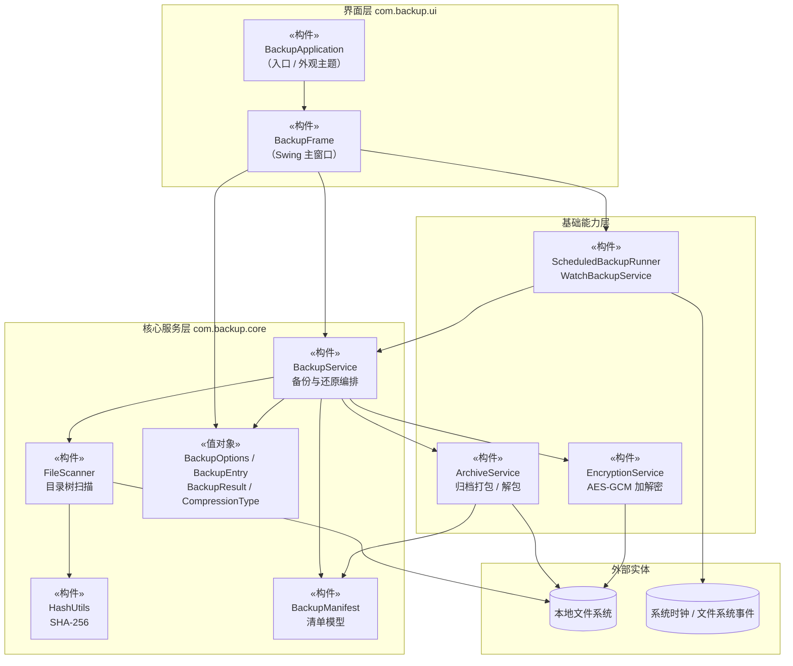

##### 2.1.1.2 构件图描述

| 构件 | 职责 | 对外提供的接口 | 依赖的构件 |
| --- | --- | --- | --- |
| **BackupApplication** | 程序入口。设置 Nimbus 外观主题与配色，在事件分发线程上创建并显示主窗口；主题设置失败时回退到系统外观 | `main(String[])` | BackupFrame |
| **BackupFrame** | 唯一的界面构件。提供三个功能页（Backup / Restore / Automation），采集用户参数并直接组装为 `BackupOptions`，以 `SwingWorker` 在后台线程执行，将进度与结果写入活动日志并更新状态徽标 | 继承 `JFrame`；无对外编程接口 | BackupService、各自动化构件、全部值对象 |
| **BackupService** | 核心业务编排者。负责参数校验、调用扫描、增量过滤、归档写入、加密、清单落盘，并返回 `BackupResult`；还原时负责格式嗅探与解密调度 | `backup(BackupOptions)`、`restore(Path, Path, char[])` | FileScanner、ArchiveService、EncryptionService、BackupManifest |
| **FileScanner** | 以不跟随符号链接的方式递归遍历源目录树，为每个目录与常规文件采集元数据并生成 `BackupEntry`，结果按相对路径排序 | `scan(Path)` | HashUtils、本地文件系统 |
| **HashUtils** | 以 64 KB 缓冲区流式计算文件的 SHA-256 摘要，返回十六进制字符串 | `sha256(Path)` | — |
| **BackupManifest** | 清单的内存模型与持久化。保存源根、创建时间、压缩类型、增量与加密标志及全部条目；支持序列化为 Properties 文本与从文本加载（含版本校验） | `store`、`load`、`fromString`、`toBytes`、`entriesByPath` | BackupEntry、CompressionType |
| **ArchiveService** | 归档容器的读写。支持 ZIP 与 GZIP 两种写入格式、按魔数自动识别格式、条目路径安全校验、元数据回填 | `writeZipArchive`、`writeGzipArchive`、`restore` | BackupManifest、BackupEntry、本地文件系统 |
| **EncryptionService** | 归档的整体加密与解密。生成盐与 IV、派生密钥、以 AES-256-GCM 加解密，并支持通过文件头魔数判断归档是否加密 | `encrypt`、`decrypt`、`decryptToTempFile`、`isEncrypted` | 本地文件系统 |
| **ScheduledBackupRunner** | 基于单线程调度器按固定周期重复执行备份任务，支持启动、停止与查询运行状态 | `start`、`stop`、`isRunning`、`close` | — |
| **WatchBackupService** | 基于 `WatchService` 监视源目录树的变化，动态注册新建目录，并在防抖窗口后触发备份 | `start`、`stop`、`isRunning`、`close` | 文件系统事件 |

**关键结构决策**

1. **依赖方向单向**：界面层 → 核心服务层 → 基础能力层，无反向依赖，也无跨层旁路（界面不直接读文件、核心层不感知界面）。
2. **依赖注入**：`BackupService` 通过构造器显式接收 `FileScanner`、`ArchiveService`、`EncryptionService`，并保留一个无参构造器提供默认装配。这使得核心逻辑可在测试中被替换或独立实例化。
3. **不可变值对象**：`BackupOptions`、`BackupEntry`、`BackupResult` 均为 Java `record`，跨层传递时不存在共享可变状态，天然避免并发修改问题。
4. **压缩算法可扩展**：压缩算法以枚举 `CompressionType` 表达，`BackupService.writeArchive` 与 `ArchiveService` 中的分发使用穷尽 `switch`，新增算法时编译器会强制补齐分支。

#### 2.1.2 子系统一：备份核心子系统（CORE）

##### 2.1.2.1 构件图

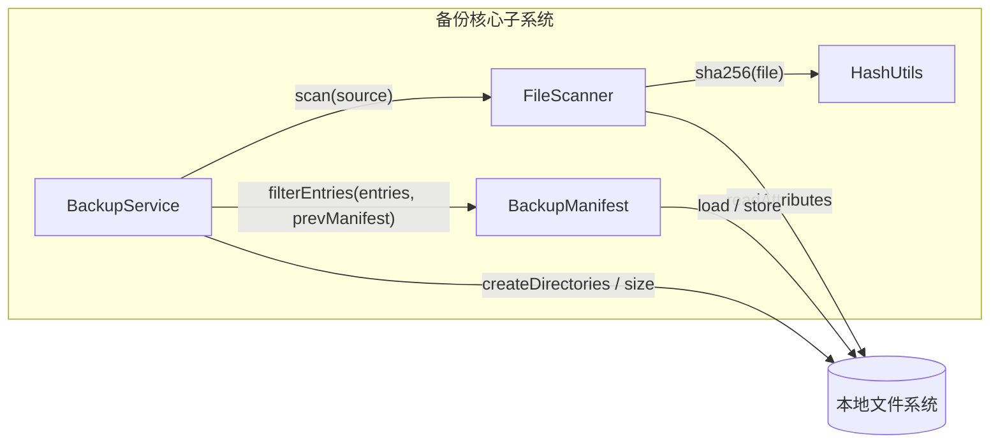

##### 2.1.2.2 构件图描述

备份核心子系统负责「从源目录树到待归档条目列表」的全部逻辑，是增量备份正确性的唯一责任方。

**扫描阶段（FileScanner）**

- 使用 `Files.walkFileTree` 递归遍历，`preVisitDirectory` 收集目录（根目录自身除外），`visitFile` 仅收集常规文件（跳过管道、设备等特殊文件）。
- 相对路径以 `root.relativize()` 计算，并将 Windows 的反斜杠统一替换为正斜杠，保证清单在不同平台上的可移植性。
- 元数据读取使用 `LinkOption.NOFOLLOW_LINKS`，**不跟随符号链接**，避免链接环路导致无限递归或越界读取。
- 目录的尺寸与摘要字段置空（尺寸记 0、摘要记空串），因为它们不参与增量比对的内容判定。
- POSIX 属性读取失败（如 Windows）时降级为「权限为空串 + 尽力读取属主」，不中断扫描。
- 结果按相对路径排序，保证同一次扫描在不同平台、不同文件系统遍历顺序下产出稳定一致的清单。

**增量判定阶段（以下算法为 v1；v2 规则见文首）**

这是本子系统中业务规则最集中的部分，判定规则如下：

| 条目类型 | 判定为「需要归档」的条件 |
| --- | --- |
| 目录 | 始终归档（目录条目体积为 0，归档它们是为了在还原时保留空目录结构） |
| 常规文件 | 上一次清单中不存在同路径条目，或其 SHA-256 与上次不同 |

v1 设计取舍（已替代）：**只以文件内容的 SHA-256 摘要为准，而非修改时间戳**。v2 还比较修改时间和其他元数据。原设计说明：原因是时间戳易被复制、touch、版本控制检出等操作改变，以其为依据会产生大量「时间变了但内容没变」的伪增量；而 SHA-256 直接反映内容，判定结果与用户直觉一致。代价是每次备份都需完整读取一遍文件内容计算摘要，见 4.1 节性能分析。

**清单阶段（BackupManifest）**

需特别说明的一点：**写入归档的条目集合与写入清单的条目集合是不同的**。

- **归档**中只写入本次判定的增量条目（`archivedEntries`）；
- **清单**中写入**本次扫描到的全部条目**（`scannedEntries`）。

这是增量备份能够连续运作的前提：清单记录的是「备份完成时刻源目录树的完整快照状态」，下一次增量备份以此为基线比对，才能正确识别变化。若清单只记录增量条目，则未变化文件会在下一次比对中因「上一次清单中不存在该路径」而被误判为新增，导致每次备份都退化为全量。

##### 2.1.3 子系统二：归档与加密子系统（IO + CRYPTO）

##### 2.1.3.1 构件图

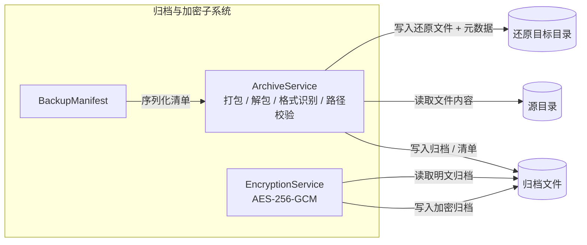

##### 2.1.3.2 构件图描述

**归档格式设计**

系统支持两种归档容器，其内部布局如下：

| 格式 | 扩展名 | 内部布局 |
| --- | --- | --- |
| **ZIP** | `.zip` | 标准 ZIP 容器。首个条目为清单 `BACKPACK-MANIFEST.properties`；数据条目统一置于 `data/` 前缀之下；目录条目以 `/` 结尾 |
| **GZIP** | `.bpgz` | GZIP 容器，内部为自定义定长帧：魔数 `BACKPACK-GZIP-1` → 清单字节长度（4 字节）→ 清单字节 → 条目总数（4 字节）→ 逐条目（相对路径 → 是否目录 → 尺寸 → 修改时间 → 内容） |

两种格式的设计意图不同：

- ZIP 使用 `data/` 前缀隔离数据条目，好处是**产出的归档可被通用解压工具直接打开检视**，用户无需本产品即可确认备份内容，降低了「备份是否真的存在」的信任成本；`data/` 前缀同时保证了清单文件不会与用户的同名文件冲突。
- GZIP 采用自定义帧，换取的是**更高的压缩率**（单一压缩流，无 ZIP 的逐条目头部开销）与**更紧凑的元数据表达**。

**格式识别（ArchiveService.detectKind）**

还原时不依赖文件扩展名，而是读取文件头部字节判定：

- 前 4 字节为 `PK`（`0x50 0x4B`）→ ZIP
- 前 2 字节为 `0x1F 0x8B` → GZIP
- 其余 → 抛出「Unsupported archive type」错误

不以扩展名判定的原因：用户可能重命名文件，扩展名不可信；归档也可能由用户复制后重命名。

**路径安全校验（ArchiveService.safeResolve）**

安全性由「解析 → 规范化 → 前缀校验」三步保证：

1. 将条目相对路径拼接到还原目标目录，得到候选路径；
2. 调用 `Path.normalize()` 消解路径中的 `.` 与 `..` 段；
3. 校验规范化结果是否仍以还原目标目录为前缀，否则抛出「Archive entry escapes restore directory」并**中止整个还原**。

这一步是防御「恶意归档通过 `../../etc/passwd` 之类的条目名在还原目录之外写文件」的关键措施。`applyManifestMetadata` 中还原时间戳与权限前，也重复执行了同样的前缀校验，避免清单本身被篡改后绕过检查。

**元数据还原（applyManifestMetadata）**

还原的最后一步遍历清单，对每个存在对应实体的条目：

- 还原最后修改时间；
- 若清单中权限字符串非空，解析为 `PosixFilePermission` 集合并写入。

当前 v2 同时尝试权限、属主、属组及修改/访问/创建时间，采用**尽力而为 + 警告**：捕获平台不支持与权限类异常并记录警告。理由是部分文件系统（如 FAT）根本不支持这些属性，若因此中止还原，将导致「主体数据本可恢复却因元数据失败而全部失败」，违背数据可用性优先的原则。

**加密设计（EncryptionService）**

加密作用于**归档整体**（加密整个 `.zip`/`.bpgz` 文件），而非逐个文件条目。加密产物的文件结构为：

```
魔数 "BPACKENC1"（9 字节，US-ASCII）
│ 用于在还原时判定"这是否为本产品的加密归档"
├─ 盐长度（int, 4 字节）
├─ 盐（16 字节，每次加密重新生成）
├─ IV 长度（int, 4 字节）
├─ IV（12 字节，每次加密重新生成）
└─ AES-256-GCM 密文 + 128 位认证标签
```

密钥派生与加密参数：

| 参数 | 取值 | 依据 |
| --- | --- | --- |
| 密钥派生函数 | PBKDF2-HMAC-SHA256 | 抗暴力破解的标准口令派生方案（RFC 8018） |
| 迭代次数 | 210000 | 显著抬高离线字典攻击成本，同时保持在桌面环境可接受的耗时内 |
| 密钥长度 | 256 位 | AES-256 |
| 加密算法与模式 | AES/GCM/NoPadding | 认证加密，同时保证机密性与完整性（NIST SP 800-38D） |
| 认证标签长度 | 128 位 | GCM 最大标签，认证强度最高 |
| 盐 / IV 长度 | 16 字节 / 12 字节 | GCM 推荐的 IV 长度 |

**两个刻意的安全细节**：

1. **盐与 IV 每次加密都重新生成**，而非固定或从口令派生。这保证了相同口令加密同一内容两次会产生完全不同的密文，避免「相同口令可识别相同备份」的模式泄露。
2. **口令全程以 `char[]` 处理**，不使用 `String`（`String` 不可变，会长期驻留堆内存直至 GC，扩大内存取证窗口）。`BackupOptions` 的 `passphrase()` 访问器返回数组**副本**而非内部引用，避免调用方意外改写内部状态；密钥派生完成后立即用全零覆写派生出的密钥字节，并调用 `PBEKeySpec.clearPassword()` 清除口令副本。

**加密流程的一处已知局限**（详见需求分析说明书 LIM-01）：当前实现先将明文归档写入目标目录的临时文件，加密完成后再删除该临时文件。这意味着加密完成前磁盘上存在一个短暂的明文窗口。改进方向是改为「边压缩边加密」的流式管道（`CipherOutputStream` 直接包裹压缩输出流），彻底消除明文落盘。当前实现的取舍理由是：加密作用于完整归档，密文头部需要先写入盐与 IV，而与压缩流直接串联在实现复杂度上更高，在课程项目时间约束下选择了先落盘再加密。

### 2.1.4 子系统三：自动化子系统（AUTO）

#### 2.1.4.1 构件图

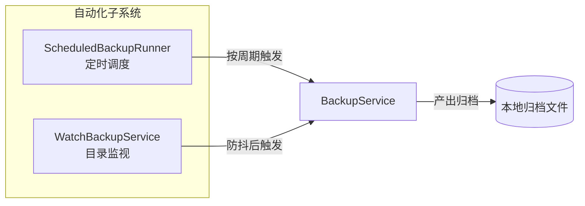

#### 2.1.4.2 构件图描述

**定时备份（ScheduledBackupRunner）**

- 使用 `Executors.newSingleThreadScheduledExecutor` 创建单线程调度器，线程设为**守护线程**并命名（`backup-scheduled-backup`），便于线程转储时识别，且不阻止 JVM 退出。
- 以 `scheduleAtFixedRate` 按固定频率触发，周期由用户以分钟为单位指定，内部转换为秒并强制下限为 1 秒。
- 所有状态变更方法（`start` / `stop` / `isRunning` / `close`）均加 `synchronized`，保证界面线程与调度线程之间的可见性。
- `start` 内部先调用 `stop()`，即**重复启动等价于重新配置周期**，避免出现两个并行调度。
- 取消时使用 `cancel(false)`：已在执行中的任务允许跑完，不做中断。这是有意的取舍——中断一个正在写归档的备份任务可能产出损坏的归档，让当前任务完成后停止更为安全。

**实时备份（WatchBackupService）**

设计要点集中在以下四处：

1. **递归注册**：`WatchService` 只能监视单个目录且不递归，因此在启动时用 `walkFileTree` 为源目录树的每个子目录单独注册 `WatchKey`，并用 `Map<WatchKey, Path>` 维护「监视键 → 目录」的反向映射。
2. **动态注册新目录**：当收到 `ENTRY_CREATE` 事件且目标为目录时，立即递归注册该新目录。否则在监视启动后新建的子目录内的变化将完全丢失。
3. **防抖（debounce）**：`WatchService` 在短时间内可能对一次保存操作产生多个事件（编辑器常「写临时文件 → 重命名」）。因此采用「累积脏标记 + 静默期判定」策略：事件到达时置 `dirty` 并记录时间戳；轮询循环中若 `dirty` 且距最后一次事件已超过防抖窗口，才触发一次备份。防抖窗口下限 250 ms，默认 5 秒。
4. **失效键清理**：`key.reset()` 返回 `false` 表示该目录已被删除或不可访问，此时从映射中移除该键，避免内存中积累无效条目。

线程模型：单线程执行器（`backup-watch-service`），主循环以 `poll(500ms)` 轮询而非 `take()` 阻塞，使 `running` 标志的变更能在最多 500 ms 内被响应，保证 `stop()` 能及时生效。

### 2.1.5 子系统四：网络子系统（NET，v3 新增）

#### 2.1.5.1 构件图

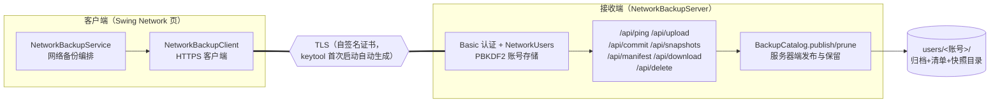

#### 2.1.5.2 构件图描述

**账号管理（NetworkUsers + PasswordHashes）**

- 账号保存在存储根的 `users.properties`：每账号记录盐值（16 字节随机）、PBKDF2-HMAC-SHA256 验证值（210000 次迭代、256 位）与迭代数；口令明文绝不落盘。
- 写入采用临时文件 + 原子移动；`authenticate` 用常数时间比较，未知用户同样执行一次推导以平衡时序。用户名约束为 `[A-Za-z0-9][A-Za-z0-9._-]{0,31}`，直接映射为 `users/<账号>/` 隔离目录，天然阻断目录穿越。

**接收服务（NetworkBackupServer）**

- 基于 JDK `HttpsServer`：首次启动用 JDK `keytool` 自动生成自签名 PKCS#12 证书（SAN 含 `localhost`/`127.0.0.1`）到 `server-keystore.p12`；所有业务端点由统一的 `authenticated` 包装执行 Basic 认证。
- 上传分两步：`POST /api/upload` 将归档流式写入用户目录的 `.incoming-<uuid>.part` 并返回令牌；`POST /api/commit` 携带令牌与完整清单文本，服务器解析清单、校验快照身份与归档名安全后，原子移动为最终归档、写清单旁挂文件、`BackupCatalog.publish` 发布快照所有权索引、写兼容性最新清单，再按 `keepGroups` 执行服务器端保留；发布失败回滚本次产物。
- 元数据管理：`GET /api/snapshots` 汇总用户全部 `.snapshot.properties`（含字节数），`GET /api/manifest?name=` 返回指定归档清单，`GET /api/download?name=` 下载归档，`POST /api/delete` 整组删除且拒绝删除含最新快照的组。请求/响应体（除归档字节流外）统一为 `Properties` 文本，规避手工 JSON 解析。
- 启动时清理残留的 `.incoming-*.part`；所有名字参数经 `[A-Za-z0-9][A-Za-z0-9._-]{0,199}` 白名单校验。

**客户端（NetworkBackupClient + NetworkBackupService）**

- `NetworkBackupClient` 封装 `HttpClient`：每请求携带 Basic 头，信任库显式指定服务器密钥库文件（信任固定），不依赖证书机构。
- `NetworkBackupService.backup` 编排：以 `BackupService.taskIdentity` 计算任务号 → 拉取该任务的服务器端最新快照与清单 → 按与本地一致的规则决定全量/增量（每任务一全量 + 至多九增量；压缩、加密开关或口令变化、链缺失时全量）→ `FileScanner` 扫描并与远端清单比对出变化条目 → 本地写归档（可选加密）→ 上传并提交。还原直接下载归档后复用本地 `BackupService.restoreDetailed`，链接、元数据与路径安全语义完全一致。

## 3. 静态建模

### 3.1 系统对象模型

> **v1 历史说明**：本小节保留原版图表、接口或编码示例；涉及固定基线续接、文件名、类型、元数据、发布顺序与索引的内容由文首 v2 修订替代，不代表当前 API。


#### 3.1.1 系统类图

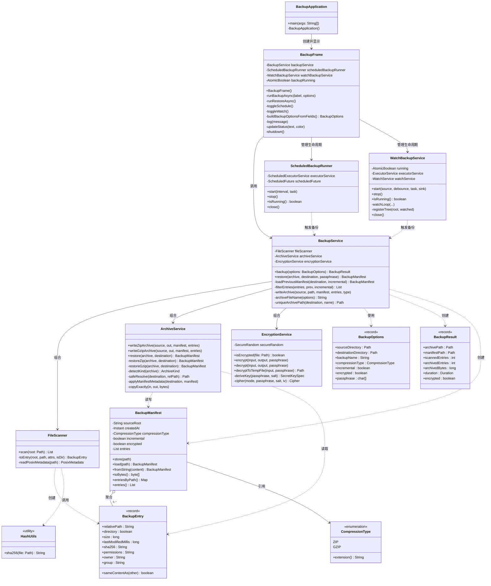

#### 3.1.2 类图描述

**关联、聚合与继承关系说明**

| 关系 | 参与方 | 基数 | 说明 |
| --- | --- | --- | --- |
| 组合 | `BackupService` ◆— `FileScanner` / `ArchiveService` / `EncryptionService` | 1 : 1 : 1 : 1 | 三者由 `BackupService` 通过构造器注入并持有，生命周期与 `BackupService` 一致；无参构造器提供默认装配 |
| 聚合 | `BackupManifest` ◇— `BackupEntry` | 1 : 0..\* | 一份清单包含零到多个条目；构造时以 `List.copyOf` 复制，条目可在多份清单间共享而不被修改 |
| 依赖 | `BackupService` ⇢ `BackupOptions` / `BackupResult` / `BackupManifest` | — | 仅作为方法参数与返回值出现，不持有引用 |
| 依赖 | `BackupFrame` ⇢ 各自动化构件 | — | 界面持有实例以管理其生命周期（启动 / 停止 / 关闭） |
| 引用 | `BackupManifest` → `CompressionType` | 1 : 1 | 记录本次备份采用的压缩算法，供还原时参考 |

**本模型无继承关系**。全部业务类均为 `final class`（或 `record`、`enum`），不使用继承。这是有意的设计选择：系统中的压缩算法以枚举表达并配合穷尽 `switch`，归档、加密与自动化通过独立构件组合，无需为「同一接口的不同实现」建立类型层级，用继承反而会引入不必要的耦合。因此本设计以**组合优于继承**为原则，全部复用通过组合与依赖注入实现。

**可见性约定**

- 所有业务类声明为 `public final`，明确禁止被继承。
- 所有字段声明为 `private final`，类一经构造即不可变（`BackupFrame` 中随交互变化的字段除外）。
- 对外暴露的方法尽量窄：`BackupOptions.passphrase()` 返回数组副本而非内部引用，是可见性收窄的典型例子。

### 3.2 类（对象）描述

> **v1 历史说明**：本小节保留原版图表、接口或编码示例；涉及固定基线续接、文件名、类型、元数据、发布顺序与索引的内容由文首 v2 修订替代，不代表当前 API。


本节按逻辑组织，为系统中的关键类提供详细说明。为控制篇幅，本节详述承担主要业务职责的 7 个类，其余构件已在 2.1 节的构件图描述中说明。

#### 3.2.1 BackupService 类

##### 3.2.1.1 类描述

`BackupService` 是系统的核心编排类，是整个备份与还原流程的唯一入口。它本身不含任何文件读写、压缩或加密的实现细节，而是通过组合 `FileScanner`、`ArchiveService`、`EncryptionService` 三个协作者，将「校验 → 扫描 → 过滤 → 打包 → 加密 → 落盘」串成完整流程。

- **作用**：编排备份与还原的业务流程；执行业务规则校验；维护增量备份的基线清单。
- **生存周期**：由 `BackupFrame` 在窗口构造时创建一次，随窗口存活至进程结束；无状态（除三个协作者引用），因此可安全地被多个线程复用——但实际使用中由 `AtomicBoolean` 保证同一时刻仅有一个备份任务执行。
- **约束**：不可被继承（`final`）。

##### 3.2.1.2 属性描述

| 属性名 | 类型 | 可见性 | 约束与说明 |
| --- | --- | --- | --- |
| `LATEST_MANIFEST_NAME` | `String`（static final） | private | 常量，值 `.backpack-manifest.properties`。用于保存「最新一次备份的清单」，作为下次增量比对的基线。该名称被刻意固定，以保证与历史版本的增量备份兼容 |
| `ARCHIVE_TIMESTAMP` | `DateTimeFormatter`（static final） | private | 常量，格式 `yyyyMMdd-HHmmss`，用于构造归档文件名 |
| `fileScanner` | `FileScanner` | private final | 目录树扫描协作者，构造后不可更换 |
| `archiveService` | `ArchiveService` | private final | 归档读写协作者 |
| `encryptionService` | `EncryptionService` | private final | 加密协作者 |

##### 3.2.1.3 方法描述

| 方法签名 | 返回类型 | 用途与算法说明 |
| --- | --- | --- |
| `BackupService()` | — | 无参构造器，以默认实现装配三个协作者，供生产代码使用 |
| `BackupService(FileScanner, ArchiveService, EncryptionService)` | — | 全参构造器，供测试或替换实现使用（依赖注入点） |
| `backup(BackupOptions)` | `BackupResult` | **主流程**。① 将源与目标目录绝对化并规范化；② 校验目标不位于源之内（`source.equals(destination) \|\| destination.startsWith(source)`），违反则抛出 `IOException`；③ 创建目标目录；④ 调用扫描获得全量条目；⑤ 若为增量模式则加载上一次清单；⑥ 过滤出待归档条目；⑦ 以**全量条目**构造清单；⑧ 生成归档文件名并解析唯一路径；⑨ 若需加密则先写出明文临时归档，再加密为最终路径，并在 `finally` 中删除临时文件；⑩ 写入 `<归档名>.manifest.properties` 与 `.backpack-manifest.properties`；⑪ 组装并返回 `BackupResult`。**Pre-condition**：`options` 中的目录非空。**Post-condition**：目标目录中存在一个合法归档及两份清单 |
| `restore(Path, Path, char[])` | `BackupManifest` | **主流程**。① 规范化归档路径；② 以 `isEncrypted` 嗅探头部魔数；③ 若已加密，校验口令非空后解密至临时文件；④ 调用 `archiveService.restore` 解包；⑤ 在 `finally` 中删除临时文件。返回还原所用清单以便界面显示条目数 |
| `loadPreviousManifest(Path, boolean)` | `BackupManifest` | 非增量模式返回 `null`；增量模式下若基线清单文件存在则加载，否则返回 `null`（使本次退化为全量） |
| `filterEntries(List, BackupManifest, boolean)` | `List<BackupEntry>` | **增量判定核心**。非增量或基线为空时原样返回全部条目；否则建立「路径 → 条目」映射，逐条判定：目录始终保留；文件在上次不存在或 `sameContentAs` 为假时保留 |
| `writeArchive(Path, Path, BackupManifest, List, CompressionType)` | `void` | 按压缩类型分派到 `writeZipArchive` 或 `writeGzipArchive`。使用穷尽 `switch`，新增压缩算法时编译期即报缺失分支 |
| `archiveFileName(BackupOptions)` | `String` | 构造归档名：`备份名-模式-时间戳.扩展名[.enc]`。备份名经 `[^A-Za-z0-9._-]+` 替换为 `-` 并去除首尾空白，全空则回退为 `backup`；模式取 `incremental` 或 `full` |
| `uniqueArchivePath(Path, String)` | `Path` | 若目标文件或同名清单已存在，则按 `-1`、`-2`… 递增追加序号直至不冲突，避免覆盖既有备份 |

**测试案例**（对应 `BackupServiceTest`）

| 编号 | 验证目标 | 输入 | 预期 |
| --- | --- | --- | --- |
| T-01 | 全量备份与还原的端到端正确性 | 源含 `docs/readme.txt`（内容 `hello`） | 清单条目数为 2，还原后内容为 `hello`，归档旁清单文件存在 |
| T-02 | 加密备份的口令校验 | GZIP + 加密，口令 `passphrase` | 以错误口令 `bad` 还原抛出 `IOException`；以正确口令还原内容为 `private` |
| T-03 | 增量过滤的正确性 | 首次全量后修改 `changed.txt`，再次增量备份 | 归档中**含** `data/changed.txt` 与 `data/docs/`，**不含** `data/docs/unchanged.txt` |
| T-04 | 目标目录位于源内的拒绝 | destination 为 `source/backups` | 抛出 `IOException` |

#### 3.2.2 BackupManifest 类

##### 3.2.2.1 类描述

`BackupManifest` 是备份清单的内存模型与持久化载体，是增量备份能力的**状态载体**——系统没有数据库，清单就是条目元数据的持久化载体；v2 另有快照所有权索引。

- **作用**：描述「某次备份完成时刻源目录树的完整快照」，并负责自身的序列化与反序列化。
- **生存周期**：每次备份创建一份新实例；还原时从归档内加载一份；实例本身不可变。
- **约束**：`sourceRoot`、`createdAt`、`compressionType` 构造时不得为空；条目列表以 `List.copyOf` 复制。

##### 3.2.2.2 属性描述

| 属性名 | 类型 | 约束与说明 |
| --- | --- | --- |
| `ARCHIVE_ENTRY_NAME` | `String`（static final） | 常量，值 `BACKPACK-MANIFEST.properties`，清单在归档内的条目名 |
| `VERSION` | `String`（static final） | 常量，值 `1`，清单格式版本。加载时若版本不符，抛出 `IOException` 而非尝试兼容解析 |
| `sourceRoot` | `String` | 源目录的绝对路径，非空 |
| `createdAt` | `Instant` | 备份创建时刻，非空 |
| `compressionType` | `CompressionType` | 本次采用的压缩算法，非空 |
| `incremental` | `boolean` | 是否为增量备份 |
| `encrypted` | `boolean` | 归档是否加密 |
| `entries` | `List<BackupEntry>` | 本次扫描到的全部条目，不可变列表 |

##### 3.2.2.3 方法描述

| 方法签名 | 返回类型 | 用途与算法说明 |
| --- | --- | --- |
| `BackupManifest(...)` | — | 构造器，对三个关键字段做非空校验，其余字段不可变 |
| `sourceRoot()` / `createdAt()` / `compressionType()` / `incremental()` / `encrypted()` / `entries()` | 对应类型 | 属性访问器 |
| `entriesByPath()` | `Map<String, BackupEntry>` | 将条目列表转为「相对路径 → 条目」映射，供增量比对与元数据回填使用。键冲突时以后者为准（`Collectors.toMap` 的合并函数取 `right`） |
| `toProperties()` | `Properties` | 私有方法，把全部字段展开为扁平键值对：元信息键（`version`、`sourceRoot`、`createdAt`、`compressionType`、`incremental`、`encrypted`、`entry.count`）+ 逐条目键 `entry.<i>.<字段>` |
| `toPropertiesString()` | `String` | 序列化为 Properties 文本 |
| `toBytes()` | `byte[]` | 序列化为 UTF-8 字节数组，用于写入归档 |
| `store(Path)` | `void` | 写入磁盘，写入前创建父目录 |
| `load(Path)` / `fromString(String)` | `BackupManifest` | 从文件或字符串反序列化。先校验 `version`，再按 `entry.count` 循环重建条目；缺失字段使用安全默认值（如尺寸 0、摘要空串） |

**格式设计说明**：清单选用 Java `Properties` 而非 JSON 或二进制格式，理由是它属于 JDK 内置（延续零依赖原则），文本可读、可人工检视、可用 `diff` 比较两次备份的差异，且对键值对的增删天然向前兼容——新增字段时旧版本读取会使用默认值。

#### 3.2.3 BackupEntry 类

##### 3.2.3.1 类描述

`BackupEntry` 是单个被备份实体（一个目录或一个常规文件）的不可变值对象，是扫描结果与清单的最小单元。

- **作用**：承载一个条目的全部元数据，并提供增量比对所需的「内容是否相同」判定。
- **生存周期**：由 `FileScanner` 创建，随清单一同持久化；在系统内不共享可变状态。
- **约束**：`relativePath` 非空；`sha256`、`permissions`、`owner`、`group` 为 `null` 时统一规整为空串。

##### 3.2.3.2 属性描述

| 属性名 | 类型 | 约束与说明 |
| --- | --- | --- |
| `relativePath` | `String` | 相对源目录根的路径，**统一使用正斜杠分隔**，非空。跨平台一致性的关键 |
| `directory` | `boolean` | 是否为目录 |
| `size` | `long` | 文件字节数；目录恒为 0 |
| `lastModifiedMillis` | `long` | 最后修改时间的毫秒时间戳 |
| `sha256` | `String` | 文件内容的 SHA-256 十六进制摘要；目录恒为空串 |
| `permissions` | `String` | POSIX 权限字符串（如 `rw-r--r--`）；平台不支持时为空串 |
| `owner` | `String` | 属主名；读取失败时为空串 |
| `group` | `String` | 属组名；读取失败时为空串 |

##### 3.2.3.3 方法描述

| 方法签名 | 返回类型 | 用途与算法说明 |
| --- | --- | --- |
| `BackupEntry(...)` | — | 构造器，校验 `relativePath` 非空，并将四个可空字符串字段规整为空串 |
| `sameContentAs(BackupEntry)` | `boolean` | **增量判定的判定函数**。规则：① `other` 为空、类型不同或尺寸不同 → `false`；② 若为目录，比较最后修改时间；③ 若为文件，比较 SHA-256 摘要。**Pre-condition**：无。**Post-condition**：返回 `true` 表示内容可视为未变。注意该方法对目录采用时间戳判定，因为目录无内容摘要可取 |

#### 3.2.4 ArchiveService 类

##### 3.2.4.1 类描述

`ArchiveService` 负责归档容器的读写，是系统中**安全边界最集中**的类——所有来自归档的外部输入在此被解析与校验。

- **作用**：写入 ZIP / GZIP 归档；识别归档格式；解包归档；校验条目路径安全性；回填元数据。
- **生存周期**：无状态，可任意实例化。
- **约束**：不可被继承。

##### 3.2.4.2 属性描述

| 属性名 | 类型 | 约束与说明 |
| --- | --- | --- |
| `ZIP_DATA_PREFIX` | `String`（static final） | 常量，值 `data/`。数据条目的统一前缀，用于把用户文件与清单文件隔离，同时让归档可被通用工具正常打开 |
| `GZIP_MAGIC` | `String`（static final） | 常量，值 `BACKPACK-GZIP-1`。自定义 GZIP 流的格式标识 |
| `ArchiveKind` | `enum`（private） | 内部枚举，取值 `ZIP` / `GZIP`，仅用于格式识别结果 |

##### 3.2.4.3 方法描述

| 方法签名 | 返回类型 | 用途与算法说明 |
| --- | --- | --- |
| `writeZipArchive(sourceRoot, output, manifest, entries)` | `void` | 先写入清单条目，再逐条目写入 `data/<相对路径>`；目录条目名以 `/` 结尾；以 `setLastModifiedTime` 把条目的修改时间写进 ZIP 头部 |
| `writeGzipArchive(sourceRoot, output, manifest, entries)` | `void` | 以 `DataOutputStream` 包裹 `GZIPOutputStream`，依次写入：魔数 → 清单长度 → 清单字节 → 条目总数 → 逐条目（路径 → 是否目录 → 尺寸 → 修改时间 → 内容） |
| `restore(Path, Path)` | `BackupManifest` | 创建目标目录，识别格式后分派到 `restoreZip` 或 `restoreGzip`，两者最后都调用 `applyManifestMetadata` |
| `restoreZip(...)` | `BackupManifest` | 流式遍历 ZIP 条目：遇清单条目则解析并暂存；遇 `data/` 前缀条目则经 `safeResolve` 后落盘。遍历结束后若清单缺失则报错 |
| `restoreGzip(...)` | `BackupManifest` | 校验魔数 → 读取并校验清单长度（上界 64 MB）→ 解析清单 → 读取条目总数（校验非负）→ 逐条目经 `safeResolve` 后按声明字节数 `copyExactly` 精确落盘 |
| `copyExactly(InputStream, Path, long)` | `void` | 按声明的精确字节数读取并写入，**读满即停**。若流提前结束则抛出「Unexpected end of archive」。使用定长读取而非「读到 EOF」是为了防止归档被截断时静默产出不完整文件 |
| `detectKind(Path)` | `ArchiveKind` | 读取头部 4 字节：`PK` → ZIP；`0x1F 0x8B` → GZIP；否则报错 |
| `safeResolve(Path, String)` | `Path` | **安全核心**。拼接后 `normalize()`，再校验结果仍以目标目录为前缀，否则报错中止 |
| `applyManifestMetadata(Path, BackupManifest)` | `void` | 遍历清单，对存在的实体还原修改时间与 POSIX 权限。**先重复执行前缀校验**防止清单被篡改绕过 `safeResolve`；各项操作失败记录警告并尽力继续 |
| `readString` / `writeString` | `String` / `void` | GZIP 帧内的长度前缀字符串读写；读取时校验长度上界 1 MB |
| `readAllUtf8(InputStream)` | `String` | 读取 ZIP 内清单条目内容为 UTF-8 字符串 |

#### 3.2.5 EncryptionService 类

##### 3.2.5.1 类描述

`EncryptionService` 提供基于口令的归档整体加密与解密。

- **作用**：生成随机盐与 IV、派生密钥、AES-256-GCM 加解密、通过魔数判断是否加密。
- **生存周期**：持有 `SecureRandom` 实例（线程安全），可复用。
- **约束**：不可被继承；口令不得以 `String` 形式传入。

##### 3.2.5.2 属性描述

| 属性名 | 类型 | 约束与说明 |
| --- | --- | --- |
| `MAGIC` | `byte[]`（static final） | 常量，值 `BPACKENC1` 的 US-ASCII 字节，9 字节。用于识别加密归档 |
| `PBKDF2_ITERATIONS` | `int`（static final） | 常量 `210000`。密钥派生的迭代次数 |
| `KEY_BITS` | `int`（static final） | 常量 `256`。派生密钥长度 |
| `SALT_BYTES` | `int`（static final） | 常量 `16`。盐长度 |
| `IV_BYTES` | `int`（static final） | 常量 `12`。GCM 推荐的 IV 长度 |
| `GCM_TAG_BITS` | `int`（static final） | 常量 `128`。认证标签长度 |
| `secureRandom` | `SecureRandom` | private final。密码学安全随机源 |

##### 3.2.5.3 方法描述

| 方法签名 | 返回类型 | 用途与算法说明 |
| --- | --- | --- |
| `isEncrypted(Path)` | `boolean` | 读取文件头部 9 字节与 `MAGIC` 比对。文件非普通文件或长度不足时直接返回 `false`，不做多余读取 |
| `encrypt(Path, Path, char[])` | `void` | ① 生成 16 字节盐与 12 字节 IV；② 派生密钥；③ 依次写入魔数 → 盐长度 → 盐 → IV 长度 → IV；④ 以 `CipherOutputStream` 流式加密写入输入文件的全部内容 |
| `decrypt(Path, Path, char[])` | `void` | ① 校验魔数；② 读取并校验盐（上界 64 字节）与 IV（上界 32 字节）；③ 派生密钥；④ 以 `CipherInputStream` 流式解密。口令错误或密文被篡改时，GCM 认证失败将抛出异常，被包装为「Unable to decrypt backup. Check the passphrase.」 |
| `decryptToTempFile(Path, char[])` | `Path` | 创建临时文件并解密至其中；失败时删除临时文件后再抛出异常，避免残留 |
| `deriveKey(char[], byte[])` | `SecretKeySpec` | 以 PBKDF2-HMAC-SHA256 派生密钥。**使用后立即以全零覆写派生密钥字节，并调用 `PBEKeySpec.clearPassword()`**，缩短敏感数据在内存中的驻留时间 |
| `readBoundedBytes(DataInputStream, int, String)` | `byte[]` | 带上下界校验的长度前缀字节读取，越界即判为损坏归档 |
| `cipher(int, char[], byte[], byte[])` | `Cipher` | 构造并初始化 `AES/GCM/NoPadding` 密码器 |
| `randomBytes(int)` | `byte[]` | 以 `SecureRandom` 生成指定长度随机字节 |

#### 3.2.6 FileScanner 类

##### 3.2.6.1 类描述

`FileScanner` 负责将源目录树转换为一组有序的 `BackupEntry`。

- **作用**：递归遍历、元数据采集、符号链接不跟随、跨平台路径规范化。
- **生存周期**：无状态。
- **约束**：不可被继承。

##### 3.2.6.2 属性描述

| 属性名 | 类型 | 约束与说明 |
| --- | --- | --- |
| `PosixMetadata` | `record`（private static） | 内部值对象，聚合 `permissions`、`owner`、`group` 三个字段，用于简化 POSIX 属性读取失败时的降级处理 |

`FileScanner` 自身**不持有任何实例字段**，是纯函数式构件，因此可被安全地并发复用。

##### 3.2.6.3 方法描述

| 方法签名 | 返回类型 | 用途与算法说明 |
| --- | --- | --- |
| `scan(Path)` | `List<BackupEntry>` | **主流程**。① 校验根为目录，否则抛出 `IOException`；② 以 `Files.walkFileTree` 遍历：`preVisitDirectory` 收集非根目录，`visitFile` 仅收集常规文件；③ 按相对路径排序后返回。**Post-condition**：返回的条目相对路径唯一且有序 |
| `toEntry(Path, Path, BasicFileAttributes, boolean)` | `BackupEntry` | 由路径与属性构造条目。相对路径经 `root.relativize()` 计算并将反斜杠替换为正斜杠；目录的尺寸与摘要置零 |
| `readPosixMetadata(Path)` | `PosixMetadata` | 以 `NOFOLLOW_LINKS` 读取 POSIX 属性；不支持时降级为「权限空串 + 尽力读取属主」 |
| `readOwner(Path)` | `String` | 通过 `FileOwnerAttributeView` 单独读取属主，供 POSIX 不可用的平台使用 |

#### 3.2.7 BackupOptions 类

##### 3.2.7.1 类描述

`BackupOptions` 是一次备份请求的全部参数，是不可变值对象，同时承担**参数校验**职责。

- **作用**：在构造时完成参数规范化与合法性校验，使下游流程可以假定输入已合法。
- **生存周期**：每次备份请求创建一个实例。
- **约束**：源目录与目标目录非空；加密时口令非空。

##### 3.2.7.2 属性描述

| 属性名 | 类型 | 约束与说明 |
| --- | --- | --- |
| `sourceDirectory` | `Path` | 非空，构造时以 `Objects.requireNonNull` 校验 |
| `destinationDirectory` | `Path` | 非空，同上 |
| `backupName` | `String` | 为空或全空白时，回退为源目录的末级目录名；源目录无末级名时回退为 `backup`；否则去除首尾空白 |
| `compressionType` | `CompressionType` | 为 `null` 时默认为 `ZIP` |
| `incremental` | `boolean` | 是否增量备份 |
| `encrypted` | `boolean` | 是否加密 |
| `passphrase` | `char[]` | `null` 时规整为空数组；**构造时即复制**，不保留外部引用 |

##### 3.2.7.3 方法描述

| 方法签名 | 返回类型 | 用途与算法说明 |
| --- | --- | --- |
| `BackupOptions(...)` | — | 紧凑构造器，执行全部规范化与校验。**校验顺序**：先非空校验 → 补默认压缩算法 → 规整备份名 → 复制口令数组 → 最后校验「加密则口令必须非空」。违反时抛出 `IllegalArgumentException`。**Post-condition**：实例字段全部非 `null`，且满足「加密 ⇒ 口令非空」不变式 |
| `passphrase()` | `char[]` | 返回口令数组的**副本**（`Arrays.copyOf`），确保内部状态不被调用方改写 |

### 3.3 其它静态建模方式

#### 3.3.1 包结构与依赖方向

```
com.backup
├── BackupApplication            （入口）
├── ui          BackupFrame                       依赖 → core, automation
├── core        BackupService                     依赖 → core, io, crypto
│               FileScanner, HashUtils
│               BackupManifest, BackupEntry
│               BackupOptions, BackupResult, CompressionType
├── io          ArchiveService                    依赖 → core（仅值对象与清单）
├── crypto      EncryptionService                 依赖 → 无业务包依赖
└── automation  ScheduledBackupRunner             依赖 → 无业务包依赖（通过 Runnable 回调）
                WatchBackupService
```

**依赖方向约束**：`crypto`、`automation` 两个包**不依赖任何其他业务包**，只依赖 JDK；`core` 依赖 `io` 与 `crypto`；`ui` 位于最上层，依赖全部。该结构保证了底层能力构件可被独立测试与替换。

#### 3.3.2 关键不变式（Invariants）

以下不变式贯穿系统，是静态结构正确性的保证：

| 编号 | 不变式 | 保证位置 |
| --- | --- | --- |
| INV-1 | 加密为真时口令必非空 | `BackupOptions` 紧凑构造器 |
| INV-2 | `BackupEntry.relativePath` 必非空，四个元数据字符串字段必非 `null` | `BackupEntry` 构造器 |
| INV-3 | 清单条目列表不可变 | `BackupManifest` 构造器中的 `List.copyOf` |
| INV-4 | 清单版本必须与当前实现一致，否则拒绝加载 | `BackupManifest.load` |
| INV-5 | 还原出的任何路径必须位于还原目标目录之内 | `ArchiveService.safeResolve` 与 `applyManifestMetadata` |
| INV-6 | 目标目录不得位于源目录之内 | `BackupService.backup` 前置校验 |
| INV-7 | 口令不得以 `String` 形式在系统内传递 | `BackupOptions.passphrase` 与 `EncryptionService` 全部签名使用 `char[]` |
| INV-8 | 相对路径统一使用正斜杠 | `FileScanner.toEntry` 中的替换 |

## 4. 动态建模

本节描述系统如何响应各种事件。共确定 3 个典型场景，覆盖两个关键用例（备份与还原）、实时备份的触发路径，以及应用的整体状态迁移。

### 4.1 系统场景

#### 4.1.1 场景：场景一 —— 执行加密的增量备份

> **v1 历史说明**：本小节保留原版图表、接口或编码示例；涉及固定基线续接、文件名、类型、元数据、发布顺序与索引的内容由文首 v2 修订替代，不代表当前 API。


##### 4.1.1.1 场景描述

用户在 Backup 页填写了源目录、目标目录、备份名称，选择 ZIP 压缩、勾选增量备份与加密并输入口令，然后点击「Back up now」。本场景描述从点击到结果呈现的完整交互，重点体现**后台线程与界面线程的分离**、**增量判定的时机**、以及**临时明文归档的生成与删除**。

该场景覆盖关键用例 UC-01，并额外包含增量与加密两个扩展分支。

##### 4.1.1.2 顺序图

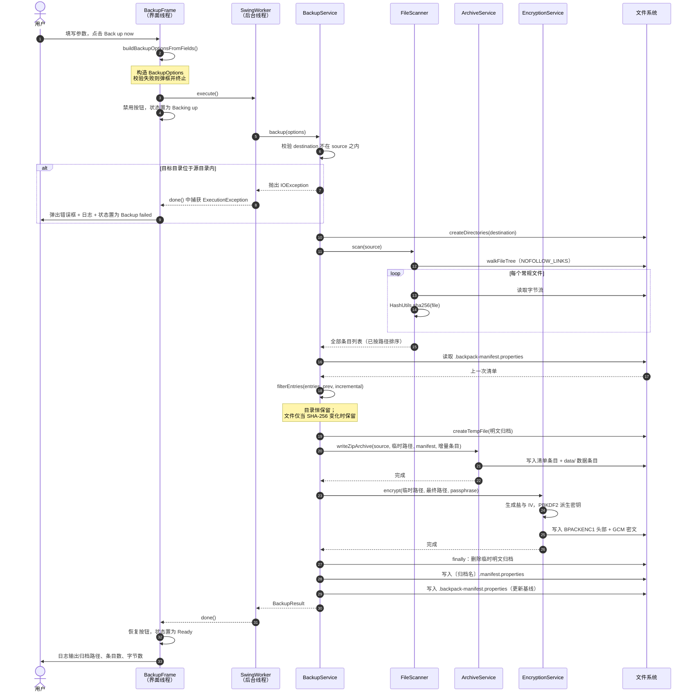

##### 4.1.1.3 流程说明

| 步骤 | 参与者 | 说明 |
| --- | --- | --- |
| 1 | 用户 → BackupFrame | 点击触发 `buildBackupOptionsFromFields()`，把界面字段组装为 `BackupOptions`。此步在界面线程同步执行，因此参数非法（如路径为空）会立即弹框，不会进入后台 |
| 2 | BackupFrame → SwingWorker | 通过 `execute()` 把耗时工作移出界面线程。**关键点**：此后所有文件 I/O 都在后台线程，界面保持可响应 |
| 3 | BackupService | 首项校验即「目标不得位于源内」。这是一项**前置失败**，避免后续扫描到一半才发现会导致自我递归 |
| 4 | FileScanner | 扫描采用不跟随符号链接的遍历。对每个常规文件计算 SHA-256，此步是备份耗时的主要来源（需完整读取一遍文件） |
| 5 | BackupService | 加载基线清单并执行增量过滤。**时机要点**：过滤发生在扫描**之后**、打包**之前**，因为判定需要每个文件的摘要，而摘要必须读取内容才能得到 |
| 6 | BackupService → ArchiveService | 加密场景下，归档先写到目标目录中的**临时明文文件**，而非最终路径 |
| 7 | BackupService → EncryptionService | 对完整的临时明文归档做整体加密，输出到最终路径（如 `name-incremental-20260921-143000.zip.enc`） |
| 8 | BackupService | 在 `finally` 块中删除临时明文归档，**无论加密成功与否都执行**，避免失败路径下残留明文 |
| 9 | BackupService | 写入两份清单：一份与归档同名（记录本次归档的内容），一份为固定的最新基线（供下次增量比对） |
| 10 | SwingWorker → BackupFrame | `done()` 在界面线程回调，读取结果或异常。异常经 `rootMessage` 逐层解包取最内层 cause，保证用户看到的是根因而非 `ExecutionException` 包装 |

**并发控制**：`BackupFrame` 持有 `AtomicBoolean backupRunning`，以 `compareAndSet` 保证同一时刻只有一个备份在执行。若定时调度或实时监视在手动备份进行中触发，本次触发被跳过并在日志中记录，状态置为 Busy——**不会排队，也不会中断正在进行的备份**。

#### 4.1.2 场景：场景二 —— 还原加密归档

> **v1 历史说明**：本小节保留原版图表、接口或编码示例；涉及固定基线续接、文件名、类型、元数据、发布顺序与索引的内容由文首 v2 修订替代，不代表当前 API。


##### 4.1.2.1 场景描述

用户在 Restore 页选择了一个 `.enc` 加密归档并指定还原目标目录，输入口令后点击「Restore」。本场景体现**格式嗅探的双层结构**（先判容器格式，再判是否加密）、**路径安全校验**、以及**元数据的尽力还原**。

该场景覆盖关键用例 UC-02。

##### 4.1.2.2 顺序图

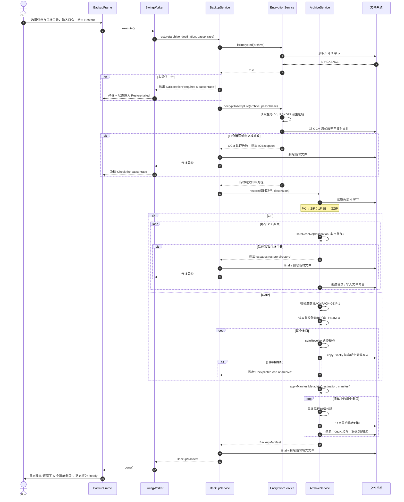

##### 4.1.2.3 流程说明

| 步骤 | 参与者 | 说明 |
| --- | --- | --- |
| 1 | BackupService → EncryptionService | **第一层嗅探**：读头部 9 字节判断是否加密。加密判定先于格式判定，因为加密归档的容器格式被封装在密文内部，必须先解密才能识别 |
| 2 | BackupService | 加密但未提供口令时，在**解密前**即失败，不做无谓的 I/O |
| 3 | EncryptionService | 解密使用 GCM 认证模式，**口令错误与密文篡改在密码学上不可区分**，都表现为认证失败。这既是安全特性（不给攻击者区分信息），也意味着错误提示需同时涵盖两种原因 |
| 4 | ArchiveService | **第二层嗅探**：解密后的明文归档再按头部字节判断是 ZIP 还是 GZIP |
| 5 | ArchiveService | 每个条目落盘前经 `safeResolve` 校验。一旦发现逃逸立即抛出异常并中止**整个还原**，不跳过该条目继续 |
| 6 | ArchiveService | GZIP 路径使用定长读取（`copyExactly`），严格按清单声明的字节数读取，防止归档截断时静默产出不完整文件 |
| 7 | ArchiveService | 元数据回填阶段**再次**执行路径前缀校验。这不是冗余：防止攻击者篡改清单、在 `applyManifestMetadata` 中构造出未经过 `safeResolve` 的路径 |
| 8 | ArchiveService | 时间戳、权限、属主与属组还原失败时给出警告并尽力继续，保证「元数据不可还原」不会导致「数据无法还原」 |
| 9 | BackupService | 临时明文文件在 `finally` 中删除，无论解密或解包是否成功 |

#### 4.1.3 场景：场景三 —— 实时备份的触发

##### 4.1.3.1 场景描述

用户在 Automation 页设置防抖时间为 5 秒并点击「Start realtime backup」。此后用户在源目录中编辑文件，系统自动感知变化并在静默 5 秒后触发一次备份。本场景体现 **WatchService 的递归注册**、**新建目录的动态注册**、**防抖策略**与**并发拒绝**。

##### 4.1.3.2 顺序图

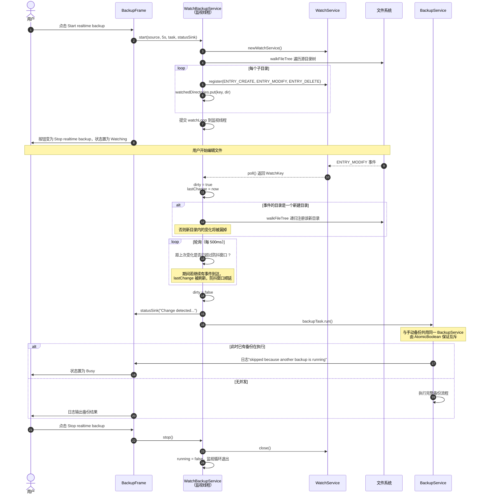

##### 4.1.3.3 流程说明

| 步骤 | 参与者 | 说明 |
| --- | --- | --- |
| 1 | WatchBackupService | 启动时递归注册源目录树的**每一个**子目录。`WatchService` 只监视单个目录且不递归，因此必须逐一注册 |
| 2 | WatchBackupService | 用 `Map<WatchKey, Path>` 维护反向映射，因为 `WatchKey` 本身不携带它是哪个目录的键 |
| 3 | WatchBackupService | 收到 `ENTRY_CREATE` 且目标是目录时**立即递归注册**。若省略此步，监视启动后新建的目录内的任何变化都将被静默漏掉 |
| 4 | WatchBackupService | 防抖采用「脏标记 + 静默期」：事件只更新 `lastChange`，只有当距最后一次事件超过防抖窗口时才触发备份。这样一次「保存」产生的多个事件（编辑器常先写临时文件再改名）只会触发一次备份 |
| 5 | WatchBackupService | 主循环用 `poll(500ms)` 而非 `take()`。`take()` 会无限阻塞，导致 `stop()` 无法及时生效；500 ms 的轮询间隔使停止操作在最多 500 ms 内被响应 |
| 6 | WatchBackupService → BackupFrame | 状态消息通过 `Consumer<String>` 回调，并经 `SwingUtilities.invokeLater` 切回界面线程后再写入日志——**Swing 组件只能在事件分发线程上访问** |
| 7 | BackupService | 实时触发的备份与手动备份共用同一实例与同一把 `AtomicBoolean` 锁，因此二者互斥，不会产生并发写入同一目标目录的竞态 |
| 8 | 清理 | `key.reset()` 返回 `false` 表示该目录已被删除，从映射中移除该键，避免无效 `WatchKey` 累积 |

### 4.2 系统状态

#### 4.2.1 应用运行状态切换

##### 4.2.1.1 状态描述

系统在界面上以顶部的 **SYSTEM STATUS 徽标**向用户呈现应用的当前状态。该状态是用户判断「系统在做什么、是否正常」的主要依据，因此其迁移规则被明确定义。

状态同时以文字与颜色编码（颜色提供快速识别，文字提供精确语义），取值如下：

| 状态名 | 徽标文字 | 颜色 | 语义 |
| --- | --- | --- | --- |
| 就绪 | `Ready` | 绿 | 无任务执行，可接受新操作。系统启动后与每次任务成功后的稳态 |
| 备份中 | `Backing up` | 蓝 | 手动或定时触发的备份正在执行 |
| 还原中 | `Restoring` | 蓝 | 还原正在执行 |
| 已调度 | `Scheduled` | 深蓝 | 定时备份已启动并等待下一次触发 |
| 监视中 | `Watching` | 深蓝 | 实时备份已启动并正在监视源目录 |
| 忙碌 | `Busy` | 橙 | 有备份正在进行，本次触发被跳过 |
| 已中断 | `Interrupted` | 橙 | 任务被中断 |
| 备份失败 | `Backup failed` | 红 | 备份以异常结束 |
| 还原失败 | `Restore failed` | 红 | 还原以异常结束 |

其中「已调度 / 监视中」两类为**驻留状态**：它们表示后台服务处于运行中，可以与「就绪」类状态并存。为控制复杂度，当前实现以单一徽标表示，即后台服务启动后徽标显示服务态，直到手动任务启动或被用户停止。

##### 4.2.1.2 状态转换图

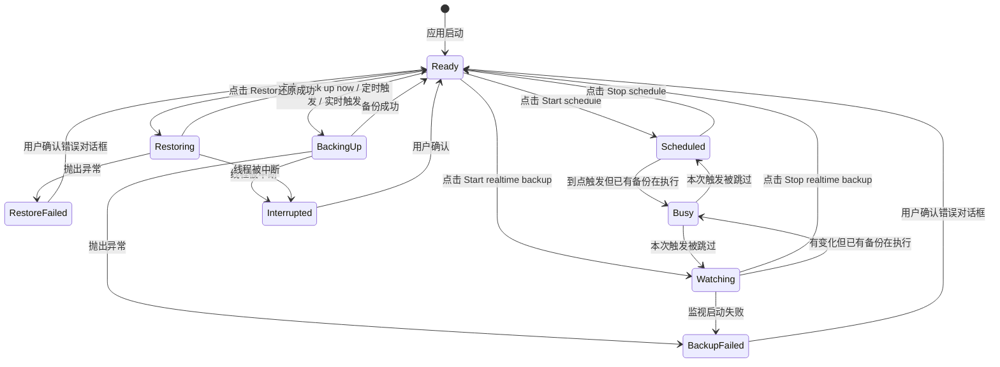

##### 4.2.1.3 状态图说明

| 状态 | 进入条件 | 退出条件 | 说明 |
| --- | --- | --- | --- |
| **Ready** | 应用启动；或任一任务成功完成；或用户关闭错误对话框 | 用户发起新任务 | 唯一的稳态。所有失败态都必须先经用户确认才能回到 Ready，保证失败不会被静默吞掉 |
| **BackingUp** | 用户点击 Back up now，或定时/实时触发 | 成功 → Ready；异常 → BackupFailed；线程中断 → Interrupted | 进入时禁用备份按钮并启动 `SwingWorker`；退出时恢复按钮 |
| **Restoring** | 用户点击 Restore | 成功 → Ready；异常 → RestoreFailed | 与备份态互不重叠，因为二者共用同一条界面操作路径 |
| **BackupFailed / RestoreFailed** | 后台任务抛出异常 | 用户确认错误对话框 → Ready | 进入时同时弹出模态错误框、写日志、徽标转红。三者冗余呈现，确保用户不会漏掉失败 |
| **Scheduled** | 用户点击 Start schedule 且参数合法 | 用户点击 Stop schedule → Ready；到点触发时转 BackingUp 或 Busy | 进入时按钮文案切换为 Stop schedule 并转为警示色 |
| **Watching** | 用户点击 Start realtime backup 且源目录可注册 | 用户点击 Stop realtime backup → Ready；启动失败 → BackupFailed | 进入后监视线程持续运行直至停止 |
| **Busy** | 定时或实时触发时，`AtomicBoolean.compareAndSet` 失败（说明已有备份在执行） | 立即回到触发前的驻留状态 | **短暂过渡态**。系统在此不做排队：本次触发被直接丢弃并记入日志，因为「上一次备份尚未完成时源目录仍在变化」，等到下次触发即可重新捕获变化 |
| **Interrupted** | 后台线程被中断 | 用户确认 → Ready | 中断时恢复线程中断标志，避免吞掉中断信号 |

**状态设计的两个原则**

1. **失败必须显式确认**：所有失败态都不能自动回到 Ready，必须经用户关闭错误对话框，防止「任务失败了但用户以为成功了」。
2. **渲染与状态解耦**：状态迁移只调用 `updateStatus(text, color)`，由该单一方法同时更新文字与颜色，避免二者不一致。

## 5. 数据库设计

### 5.1 引言

本系统**不采用任何数据库**。这一结论是本设计中的一项明确决策，而非遗漏。

**决策依据**

| 考量 | 说明 |
| --- | --- |
| 数据形态 | 系统需保存的持久化状态只有两种：① 用户数据的归档文件（二进制大对象，体量大）；② 描述归档内容的清单（结构简单，无关联查询需求） |
| 访问模式 | 清单的访问模式是「整份读取 / 整份写入」，而非「按条件查询若干行」。系统从不查询「某时间范围内变化的所有文件」这类复合条件，只做一次按路径的等值查找 |
| 关联复杂度 | 数据模型只有一个实体（条目）与一个父实体（清单），是严格的树形归属关系，不存在多对多关联，无需规范化 |
| 部署约束 | 引入数据库（即便是 SQLite）将破坏「运行期零第三方依赖」这一贯穿全局的设计原则 |
| 并发需求 | 单用户桌面工具，无并发写入场景，不需要事务隔离 |

因此，本系统以**文件系统本身作为持久化载体**，以归档文件保存业务数据、以文本清单文件保存元数据。本节的后续小节按模板要求，以「文件持久化设计」替代「数据库设计」进行说明。

### 5.2 逻辑设计

> **v1 历史说明**：本小节保留原版图表、接口或编码示例；涉及固定基线续接、文件名、类型、元数据、发布顺序与索引的内容由文首 v2 修订替代，不代表当前 API。


对应模板中「数据库逻辑设计」的位置。本系统的逻辑数据模型如下：

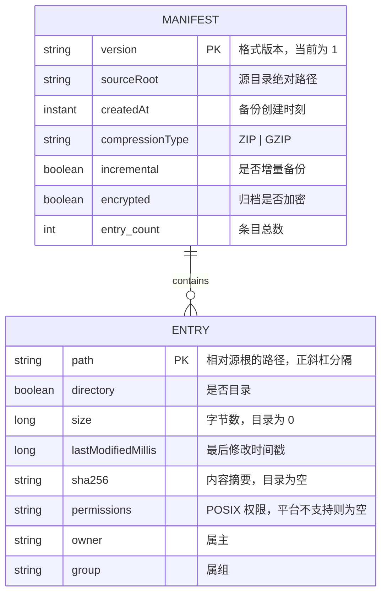

**实体关系说明**

| 关系 | 参与方 | 基数 | 说明 |
| --- | --- | --- | --- |
| 包含 | `MANIFEST` — `ENTRY` | 1 : 0..\* | 一份清单包含零到多个条目。条目以 `entry.<i>.<字段>` 的扁平键编码，序号即隐式外键 |

**与模板中 E-R 图的对应**：本模型仅含两个实体与一条一对多关系，无属性间依赖、无多对多关系、无弱实体，因此**不存在部分依赖与传递依赖**，模型天然满足第三范式（3NF）——每个非主属性都完全依赖于主键，且不存在非主属性之间的依赖。这是「单实体归属」这一简单数据形态的直接结果，而非需要刻意规范化的产物。

### 5.3 物理设计

> **v1 历史说明**：本小节保留原版图表、接口或编码示例；涉及固定基线续接、文件名、类型、元数据、发布顺序与索引的内容由文首 v2 修订替代，不代表当前 API。


对应模板中「数据库物理设计」的位置。本系统的物理存储结构如下。

**（1）存储介质与文件布局**

系统在目标目录下产生以下三类文件：

| 文件 | 命名规则 | 作用 | 生存周期 |
| --- | --- | --- | --- |
| **归档文件** | `<备份名>-<full\|incremental>-<yyyyMMdd-HHmmss><扩展名>[.enc]` | 保存被备份的数据与内嵌清单 | 长期保存，由用户管理 |
| **归档清单** | `<归档文件名>.manifest.properties` | 与归档一一对应，便于在不打开归档的情况下检视其内容 | 与归档同生命周期，归档删除时应一并删除 |
| **基线清单** | `.backpack-manifest.properties`（固定名） | 记录**最近一次**备份的完整快照，作为下次增量比对的基线 | 每次备份后覆盖更新 |

**（2）归档内部布局**

归档内部同时保存一份清单，使归档**自描述**——仅凭归档本身即可完成还原，无需依赖旁挂清单文件。这保证了归档可被单独复制、长期归档而不丢失元数据。

**（3）清单的物理编码**

清单采用 Java `Properties` 文本格式，UTF-8 编码。编码规则：

```properties
version=1
sourceRoot=/Users/example/data
createdAt=2026-09-21T14:30:00.123Z
compressionType=ZIP
incremental=true
encrypted=true
entry.count=2
entry.0.path=docs
entry.0.directory=true
entry.0.size=0
entry.0.lastModifiedMillis=1758450000000
entry.0.sha256=
entry.0.permissions=rwxr-xr-x
entry.0.owner=example
entry.0.group=staff
entry.1.path=docs/readme.txt
entry.1.directory=false
entry.1.size=5
entry.1.lastModifiedMillis=1758450000000
entry.1.sha256=2cf24dba5fb0a30e26e83b2ac5b9e29e1b161e5c1fa7425e73043362938b9824
entry.1.permissions=rw-r--r--
entry.1.owner=example
entry.1.group=staff
```

**（4）规范化处理说明**

按模板要求应对表结构进行规范化处理。对应到本系统的清单结构：

| 范式 | 满足情况 | 说明 |
| --- | --- | --- |
| **第一范式（1NF）** | 满足 | 所有字段均为原子值。条目以「序号 + 字段名」二维展开，不存在嵌套结构或多值字段 |
| **第二范式（2NF）** | 满足 | 主键为 `(entry 序号, 字段名)`，所有非主属性完全依赖于完整主键，不存在部分依赖 |
| **第三范式（3NF）** | 满足 | 不存在非主属性之间的传递依赖。例如 `sourceRoot`、`createdAt` 等元信息只存在于清单层级，不在条目层级冗余存储 |

**（5）索引设计**

对应模板中「索引设计」的位置。v1 **不建立额外索引**。以下理由仅适用于条目查询；v2 已新增快照所有权索引，用于组保留而非条目查询：

清单的读取模式是**整份加载**（`BackupManifest.load` 一次性读入全部条目），加载后由 `entriesByPath()` 在内存中构建哈希映射供后续查找。因此：

- 查找复杂度由内存中的 `HashMap` 提供，为 O(1)；
- 磁盘上建立索引无法带来收益——系统从不需要「只读取清单中的某几条」；
- 建立索引反而会引入索引与数据不一致的风险。

这一取舍的成立前提是清单规模可控。当前实现的约束是：条目常驻内存，10 万条目量级约需 100 MB 级堆内存（详见需求分析说明书 4.1 节）。

**（6）完整性与约束**

| 不变式 | 保证方式 |
| --- | --- |
| 清单版本必须匹配 | 加载时校验 `version` 字段，不匹配即拒绝加载 |
| 条目数量与实际条目一致 | 由 `entry.count` 声明；加载时按此循环重建，字段缺失使用安全默认值 |
| 路径不得逃逸还原目录 | 还原时对每个条目执行规范化与前缀校验 |
| 条目路径唯一 | 扫描结果按路径排序，且同一文件系统路径在单次遍历中只出现一次 |

---

## 附录 A：设计与实现的对应关系

| 设计内容 | 实现位置 |
| --- | --- |
| 顶层构件图（2.1.1） | `com.backup` 各子包 |
| 备份核心子系统（2.1.2） | `core/BackupService.java`、`core/FileScanner.java`、`core/HashUtils.java`、`core/BackupManifest.java` |
| 归档与加密子系统（2.1.3） | `io/ArchiveService.java`、`crypto/EncryptionService.java` |
| 自动化子系统（2.1.4） | `automation/*.java` |
| 类图（3.1） | 原 v1 源文件；新增筛选、目录索引与还原结果类见文首 v2 修订 |
| 场景一 顺序图（4.1.1） | `ui/BackupFrame.java#runBackupAsync`、`core/BackupService.java#backup` |
| 场景二 顺序图（4.1.2） | `core/BackupService.java#restore`、`io/ArchiveService.java#restore` |
| 场景三 顺序图（4.1.3） | `automation/WatchBackupService.java#watchLoop` |
| 状态转换图（4.2.1） | `ui/BackupFrame.java#updateStatus` 及各 `toggle*` 方法 |
| 清单物理编码（5.3） | `core/BackupManifest.java#toProperties` / `load` |
