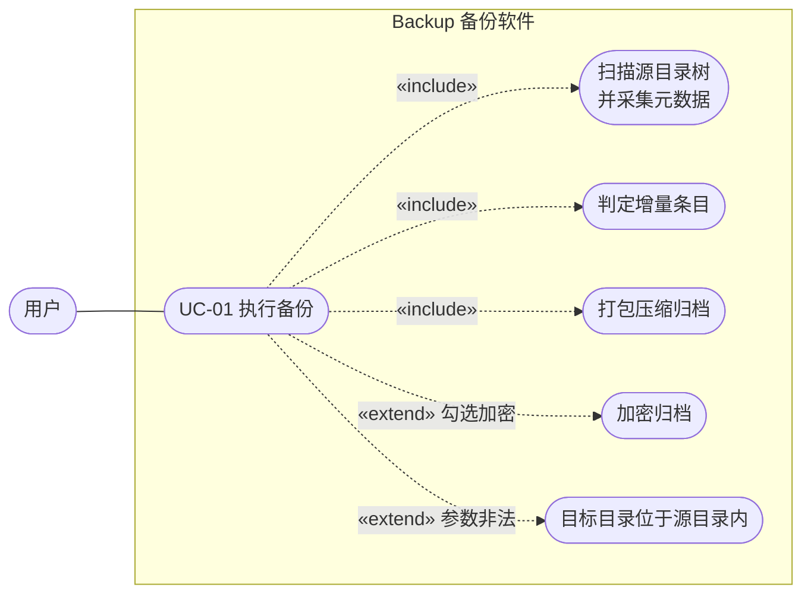
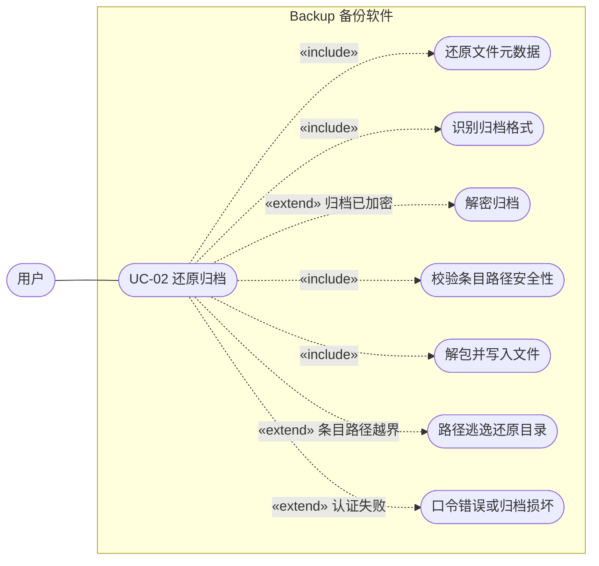
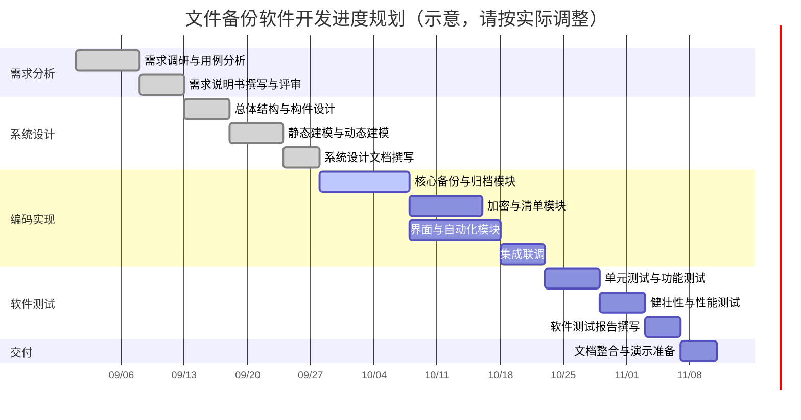

# 需求分析说明书

> 课程：软件开发综合实验　实验项目：文件备份软件　小组：【待填写】
>
> 本文档依据 `doc/实验报告模板.md` 中「需求分析说明书（10分）」的结构撰写，内容自源码反向梳理而成。

> 本轮最终补充：自动触发请求按任务分别合并，停止任务会取消其待执行请求；访问时间或创建时间单独变化通过增量清单回填，对未重新归档的对象先核验已恢复的基线内容，缺失或不匹配时提示警告，不修改不相符对象的快照属性。

> v3 新增（本节描述当前最新行为）：自定义筛选新增「属主」条件，属主按名称精确匹配、忽略大小写，属主信息缺失的条目不会命中非空属主条件；扫描可识别命名管道（FIFO）、字符设备、块设备与 Unix 域套接字（POSIX 平台经 `unix:mode` 属性），无载荷地写入清单并在还原时尽力重建（FIFO 用 `mkfifo`，设备用 `mknod`，套接字只记录不重建，失败降级为警告）；新增网络模式，内置 HTTPS 接收服务与客户端，账号以 PBKDF2 盐值哈希保存，传输走 TLS，归档清单与快照目录按用户隔离存储，增量链与服务器端清单衔接，保留淘汰在服务器端按整组执行。

## 当前实现修订（v2）

本节与下文已更新的条款共同描述当前行为。历史 v1 的固定清单续接方式已废止；未更新的历史流程细节不能用于推导 v2 的续接或删除规则。可复现步骤见[本地功能验收](本地功能验收.md)。

- **FR-CORE-06 文件筛选**：路径包含/排除与文件名采用 glob，多个值以分号分隔、同类 OR，不同条件 AND，排除优先。路径相对源根且用 `/`，文件名只匹配末级名称。扩展名忽略大小写和可选前导点；时间（毫秒）与字节数上下界均包含端点。路径/名称 glob 区分大小写，`**/` 可匹配零层目录。目录仅因明确排除规则剪枝，保留命中文件所需父目录。
- **无扩展名选项**：扩展名为空且不勾选时不限类型，勾选时只选无扩展名文件；扩展名非空且勾选时，在指定类型外加入无扩展名文件。`.env`、`name.` 视为无扩展名。
- **FR-CORE-07 分组保留**：一组为 1 次全量和至多 9 次增量，序号为 1..10，第 11 次必须新建全量组。`keepGroups=0` 关闭删除，不关闭十次轮换；正数保留该任务最新 N 个完整有效组，并保护最新快照所在组。目录中的其他任务、无关文件、未知或损坏索引、缺失依赖与无效组必须保留并警告。清理仅在成功发布后执行，失败不宣告备份主体失败。
- **任务与基线**：任务标识由源目录规范真实路径、备份名称和规范化筛选条件构成；目标目录分别保存运行期基线。每个新服务实例/进程的第一次备份为全量，不自动从旧目录续接。更改压缩、加密开关、已启用加密的口令，或在保留关闭与开启之间切换时新建全量组；正数保留组数之间调整不强制全量。基线链缺失时也新建全量组。
- **链接与元数据**：支持符号链接与文件系统可识别的硬链接；不跟随源符号链接。尽力保存/恢复权限、属主、属组、修改/访问/创建时间；不支持或无权限时给出警告。不能据此宣称所有平台均已通过验收。 符号链接的权限、属主、属组恢复在所有平台主动跳过并给出警告，防止平台 API 忽略不跟随语义而修改链接目标；链接时间仍按不跟随方式尽力设置。
- **还原语义**：手动依次还原全量及各增量；仅覆盖/新增，不同步删除源中消失的条目。拒绝目标路径中的符号链接；常规文件通过临时文件原子替换，避免改写目标目录外硬链接的内容。旧 v1 ZIP、GZIP、加密归档仍可读取。
- **产物**：归档名称包含时间戳与 UUID；每份有 `.manifest.properties` 清单与 `.snapshot.properties` 所有权索引。旧 `.backpack-manifest.properties` 仍写入，不能用作跨进程自动续接依据。产品仅处理本地文件系统中的归档。

## 1. 任务概述

### 1.1 引言

本文档是文件备份软件（下称 Backup）的软件需求规格说明，用于明确该软件的作用范围、功能需求、外部接口需求与非功能需求，作为后续系统设计、编码实现与软件测试的依据。

本文档的预期读者包括：项目组开发人员、课程指导教师，以及参与验收与测试的人员。

**术语与缩略语**

| 术语 | 说明 |
| --- | --- |
| 归档（Archive） | 一次备份操作产出的单个文件，内含被备份文件的数据与一份清单（Manifest） |
| 清单（Manifest） | 记录某次备份所涵盖的全部条目及其元数据（路径、类型、尺寸、修改时间、SHA-256、权限、属主、属组）的结构化文本 |
| 全量备份 | 备份源目录树的全部内容 |
| 增量备份 | 仅备份相对上一次备份发生变化的条目 |
| GCM | Galois/Counter Mode，一种带认证的对称加密工作模式 |
| PBKDF2 | Password-Based Key Derivation Function 2，基于口令的密钥派生函数 |
| POSIX 元数据 | 类 Unix 文件系统上的权限位、属主、属组信息 |

**参考资料**

1. GB/T 8567-2006《计算机软件文档编制规范》
2. Oracle. *Java Platform, Standard Edition 21 API Specification*.
3. NIST SP 800-38D. *Recommendation for Block Cipher Modes of Operation: GCM and GMAC*.
4. RFC 8018. *PKCS #5: Password-Based Cryptography Specification Version 2.1*（PBKDF2）.

### 1.2 综合描述

#### 1.2.1 产品的状况

Backup 是一款**新型的、自主型**的桌面数据备份工具，独立运行，不属于任何既有产品系列，也非成熟产品的下一代版本。它不构成更大系统的组成部分，亦不与外部系统存在固有的从属关系。

在被备份软件替代的既有方案方面，Backup 的定位如下：

| 既有替代品 | Backup 的差异 |
| --- | --- |
| `tar` / `zip` 等命令行归档工具 | 提供图形界面，备份与还原过程可视化；内置增量判定与加密，无需组合多个命令 |
| `rsync` 等同步工具 | 面向「快照归档」而非「镜像同步」，产出物为可独立保存与复制的单一归档文件 |
| Duplicati、7-Zip 等图形备份/压缩工具 | 运行时不依赖任何第三方运行库，仅需 JDK；归档格式自定义且自带清单，可校验可追溯 |

本产品为本地桌面备份工具，仅访问用户指定的本地文件系统路径，不与外部服务交换数据。

#### 1.2.2 产品的功能

Backup 的主要功能按业务层面概括如下，各项规格说明详见第 2 节。

**基本功能（对应基础分）**

1. **数据备份**：将指定源目录树中的文件与目录保存到指定位置的归档文件中，并在归档内写入一份完整清单。
2. **数据还原**：将归档中的内容恢复到指定目标位置，并尽可能还原其时间、权限、属主与属组，失败时给出警告。

**扩展功能**

3. **文件类型支持**：递归遍历源目录树，识别目录、常规文件、符号链接和可识别的硬链接，对符号链接采用不跟随（`NOFOLLOW_LINKS`）策略。
4. **元数据支持**：采集并保存文件尺寸、最后修改时间、SHA-256 摘要、POSIX 权限位、属主与属组。
5. **自定义备份**：由用户指定备份名称，据此生成归档文件名；名称中的非安全字符会被规整。用户还可按路径、文件名、扩展名、属主、修改时间与字节尺寸组合筛选需要备份的条目。
6. **打包解包**：将所有待备份条目拼接为单一归档文件。
7. **压缩解压**：提供 ZIP 与 GZIP 两种压缩算法供用户选择。
8. **加密解密**：由用户指定口令，对产出归档整体加密保存；还原时校验口令正确性。
9. **图形界面**：提供 Swing 图形界面，含备份、还原、自动化与网络四个功能页。
10. **定时备份**：允许用户设定周期（分钟），按固定频率重复执行备份。
11. **实时备份**：自动感知源目录树中的文件变化，经防抖延迟后自动触发备份。
12. **网络备份**：内置网盘模式。接收端提供多用户管理（PBKDF2 盐值哈希存储）、按用户隔离的归档与元数据管理、TLS 传输加密、以服务器清单为基线的增量备份，以及服务器端的按组保留淘汰与手动删除。

**非作用领域**

以下内容明确**不属于**本产品范围：细粒度的多用户权限分级（网络账号仅区分存储隔离，不设管理员/配额体系）、跨主机本地目录同步、归档内容的在线浏览与部分还原、对 Windows ACL 或 macOS 扩展属性的保存与还原、云端对象存储对接、公网服务化部署（内置证书为自签名，面向局域网/本机使用）。

#### 1.2.3 用户类和特性

| 用户类 | 特征 | 关注点 |
| --- | --- | --- |
| **普通个人用户**（主要用户类） | 具备基本计算机操作能力，不熟悉命令行；需要在个人电脑上定期保存重要资料 | 界面直观、操作步骤少、出错时有明确提示；不希望理解压缩与加密的技术细节 |
| **技术用户 / 开发人员**（重要用户类） | 熟悉文件系统与压缩/加密概念；需要将备份纳入既有工作流 | 可选的加密与压缩策略、增量备份的判定依据、归档文件的格式兼容性与可校验性 |
| **系统管理员**（次要用户类） | 负责本机数据保护；关注权限与属主能否正确还原 | POSIX 元数据的保真度与还原时的路径安全性 |

各用户类对归档产物的共同关注点为：**归档必须可被独立保存、可被完整还原、在存储与还原过程中不被越权访问**。

### 1.3 运行环境

#### 1.3.1 基本配置

**（1）硬件平台**

- 处理器：x86-64 或 ARM64 架构，支持 SSE2 / NEON 指令集（JDK 21 的最低要求）
- 磁盘：源目录与目标目录所需空间由被备份数据量决定，无需额外固定空间

**（2）操作系统**

- Windows 10 及以上
- Linux（内核 2.6.13 及以上，需支持 `inotify` 以使用实时备份功能）
- macOS 11 (Big Sur) 及以上

**（3）编译与运行环境**

- JDK 21（或更高版本），须支持 `java.nio.file.WatchService` 与 `javax.crypto`
- Apache Maven 3.9 及以上（仅构建时需要）

#### 1.3.2 其他配置

**（1）内存**

- 最低 512 MB 可用堆内存
- 备份与还原过程采用固定大小的流式缓冲区（64 KB），内存占用不随被备份文件的大小增长
- 内存占用随**条目数量**线性增长（清单常驻内存），每条目约数百字节

**（2）硬盘**

- 目标磁盘可用空间应不小于「源目录总大小 × 压缩后比率」，加密归档另需与归档等量的临时空间
- 还原目标磁盘可用空间应不小于归档解压后的总大小

## 2. 功能需求

本节详细列出与系统功能相关的需求，并对每一项需求做唯一标识。标识规则为 `FR-<模块代号>-<序号>`。

### 2.1 功能划分

依据用户业务，系统划分为五个功能模块，与源码包结构一一对应：

| 模块代号 | 模块名称 | 源码包 | 职责 |
| --- | --- | --- | --- |
| CORE | 备份核心 | `com.backup.core` | 备份与还原的流程编排、增量判定、元数据采集、清单读写 |
| IO | 归档读写 | `com.backup.io` | 归档文件的打包与解包，压缩、格式识别、路径安全校验 |
| CRYPTO | 加密服务 | `com.backup.crypto` | 基于口令的归档加密与解密 |
| AUTO | 自动化 | `com.backup.automation` | 定时备份调度与源目录变化监视 |
| NET | 网络 | `com.backup.network` | TLS 接收服务、账号管理、网盘客户端与网络增量编排 |
| UI | 图形界面 | `com.backup.ui` | 用户交互、参数采集、任务异步执行与日志呈现 |

**功能需求一览**

| 需求编号 | 需求名称 | 所属模块 | 优先级 |
| --- | --- | --- | --- |
| FR-CORE-01 | 源目录树扫描与元数据采集 | CORE | 高（基本） |
| FR-CORE-02 | 全量备份 | CORE | 高（基本） |
| FR-CORE-03 | 增量备份 | CORE | 中（扩展） |
| FR-CORE-04 | 清单生成与持久化 | CORE | 高（基本） |
| FR-CORE-05 | 归档还原 | CORE | 高（基本） |
| FR-CORE-06 | 文件筛选（路径/类型/名字/属主/时间/尺寸） | CORE | 中（扩展） |
| FR-CORE-07 | 分组保留 | CORE | 中（扩展） |
| FR-CORE-08 | 特殊文件类型（管道/设备/套接字） | CORE | 中（扩展） |
| FR-IO-01 | ZIP 归档打包与解包 | IO | 高（扩展） |
| FR-IO-02 | GZIP 归档打包与解包 | IO | 中（扩展） |
| FR-IO-03 | 归档格式自动识别 | IO | 高（基本） |
| FR-IO-04 | 还原路径安全校验 | IO | 高（基本） |
| FR-IO-05 | 元数据还原 | IO | 中（扩展） |
| FR-CRYPTO-01 | 归档加密 | CRYPTO | 中（扩展） |
| FR-CRYPTO-02 | 归档解密与口令校验 | CRYPTO | 中（扩展） |
| FR-AUTO-01 | 定时备份 | AUTO | 中（扩展） |
| FR-AUTO-02 | 实时备份 | AUTO | 中（扩展） |
| FR-NET-01 | 网盘接收服务（TLS） | NET | 中（扩展） |
| FR-NET-02 | 用户管理（PBKDF2 账号存储） | NET | 中（扩展） |
| FR-NET-03 | 元数据管理（清单/快照目录按用户隔离） | NET | 中（扩展） |
| FR-NET-04 | 传输加密（HTTPS/TLS + Basic 认证） | NET | 中（扩展） |
| FR-NET-05 | 网络增量备份与服务器端保留 | NET | 中（扩展） |
| FR-UI-01 | 图形界面与参数采集 | UI | 高（扩展） |
| FR-UI-02 | 任务异步执行与日志呈现 | UI | 高（扩展） |

**关键约束**

- FR-CORE-02 / 03：目标目录**不得**位于源目录之内，否则应拒绝执行并给出明确错误。该约束用于防止备份过程自我递归、无限膨胀。
- FR-CORE-03：增量判定同时比较类型、尺寸、内容摘要、修改时间、链接目标、权限与属主/属组；目录条目始终保留。
- FR-CORE-06：属主条件仅在条目记录了属主信息时参与匹配；记录为空的条目（如采集失败降级）不会命中任何非空属主条件。属主筛选与其它条件按 AND 组合，参与任务身份计算。
- FR-CORE-08：特殊文件无数据载荷，清单记录其类型、权限与属主/属组；设备文件以「主设备号：次设备号」形式记录设备号。还原重建依赖平台工具（`mkfifo`/`mknod`）与权限，套接字只记录不重建；任何失败均降级为警告，不中断整体还原。
- FR-NET-02：账号口令绝不落盘，仅保存 PBKDF2-HMAC-SHA256 盐值验证值；校验采用常数时间比较，未知用户同样消耗一次推导以平衡时序。
- FR-NET-04：所有业务请求必须在 TLS 信道内携带 Basic 凭据；用户名约束为 `[A-Za-z0-9][A-Za-z0-9._-]{0,31}` 并映射到隔离目录，归档名与参数均做防目录穿越校验。
- FR-NET-05：网络增量与本地语义一致——每任务一全量加至多九增量；压缩、加密开关或口令变化、以及服务器无可用链时退化为全量。保留淘汰与整组删除均在服务器端执行，且始终保护含最新快照的组。
- FR-IO-04：任何归档条目在还原时若解析结果逃逸出还原目标目录，必须立即中止并报错。

### 2.2 系统用例

依模板要求，本节仅描述 2 个业务逻辑较为复杂、且对系统正确性最为关键的关键用例。

#### 2.2.1 用例编号 UC-01：执行备份

##### 2.2.1.1 用例图

> 说明：Mermaid 无原生 UML 用例图语法，此处以 flowchart 近似表达。如需正式图，建议在 Word 中用 UML 建模工具重绘。

##### 2.2.1.2 用例描述

| 项目 | 内容 |
| --- | --- |
| **用例名称** | 执行备份 |
| **用例编号** | UC-01 |
| **范围** | 文件备份软件（本地模式） |
| **主执行者** | 用户 |
| **次要执行者** | 定时调度器（FR-AUTO-01）、目录监视器（FR-AUTO-02） |
| **涉众及关注点** | 用户：备份是否完整、是否成功、耗时与体积；系统管理员：元数据是否被正确保存 |
| **前置条件** | 1. 用户已指定存在的源目录；2. 用户已指定可写目标目录；3. 若勾选加密，用户已输入非空口令 |
| **成功保证** | 目标目录中生成归档、对应清单和快照索引，并更新兼容性最新清单；归档中包含清单及全部待备份条目；若启用加密，归档以 GCM 认证加密保存 |

**主成功场景**

1. 用户进入「Backup」页，依次填写源目录、目标目录、备份名称，选择压缩算法，并按需勾选增量备份与加密、填写口令。
2. 用户点击「Back up now」。
3. 系统校验参数：源目录与目标目录非空、目标目录不在源目录之内、加密时口令非空。校验不通过则转扩展场景 3a。
4. 系统以不跟随符号链接的方式递归遍历源目录树，为每个目录与常规文件生成一条条目，采集其相对路径、类型、尺寸、最后修改时间；对常规文件计算 SHA-256 摘要，对具备 POSIX 属性的文件采集权限位、属主与属组。
5. 若请求增量且当前实例存在兼容、完整且未达到十次上限的任务基线，系统按路径与内容/元数据比对，仅归档变化条目及目录；否则创建全量组。
6. 系统按「备份名-模式-时间戳-UUID.扩展名[.enc]」构造归档文件名，并检查归档和两个旁挂文件是否冲突。
7. 系统将清单与待备份条目写入归档：ZIP 模式下清单名为 `BACKPACK-MANIFEST.properties`，数据条目置于 `data/` 前缀下；GZIP 模式下先写入魔数、清单长度与清单，再依次写入各条目。
8. 若启用加密，系统生成 16 字节随机盐与 12 字节随机 IV，以 PBKDF2-HMAC-SHA256 迭代 210000 次派生出 256 位密钥，用 AES-256-GCM 加密归档，加密完成后**删除**明文临时归档。
9. 系统在目标目录写入 `<归档名>.manifest.properties`、原子发布 `<归档名>.snapshot.properties`，再写兼容性最新清单 `.backpack-manifest.properties`；更新内存基线后执行按组保留。
10. 系统在活动日志中输出备份结果（归档路径、条目数、字节数），状态标识复位为就绪。

**扩展场景**

- **3a. 目标目录位于源目录之内**：系统抛出错误「Destination directory must not be inside the source directory.」，界面弹出错误对话框，用例终止。
- **3b. 加密已勾选但口令为空**：系统抛出错误「Encrypted backups require a passphrase.」，界面弹出错误对话框，用例终止。
- **5a. 增量备份但无可用兼容运行期基线**：系统退化为全量备份，备份源目录树的全部条目。
- **9a. 归档文件写入过程中发生 I/O 错误**：系统终止写入，界面弹出错误对话框并在日志中记录根因；已加密场景下，临时明文归档在 `finally` 块中被删除。
- **并发场景**：若已有一次备份正在执行，系统跳过本次触发，在日志中记录「another backup is running」，并将状态标识置为 Busy。

#### 2.2.2 用例编号 UC-02：还原归档

##### 2.2.2.1 用例图

##### 2.2.2.2 用例描述

| 项目 | 内容 |
| --- | --- |
| **用例名称** | 还原归档 |
| **用例编号** | UC-02 |
| **范围** | 文件备份软件（单机模式） |
| **主执行者** | 用户 |
| **次要执行者** | 文件系统（权限与时间戳的写入方） |
| **涉众及关注点** | 用户：数据能否完整取回；系统管理员：还原是否可能覆盖或污染还原目录之外的路径；安全关注方：口令错误时是否安全失败 |
| **前置条件** | 1. 用户已指定存在的归档文件；2. 用户已指定还原目标目录；3. 若归档已加密，用户已输入口令 |
| **成功保证** | 归档中全部条目被恢复到目标目录下；各条目的最后修改时间与 POSIX 权限被尽力还原；还原过程中无任何文件被写到目标目录之外 |

**主成功场景**

1. 用户进入「Restore」页，填写归档文件路径与还原目标目录，并按需填写口令。
2. 用户点击「Restore」。
3. 系统读取归档头部 4 字节判定格式：`PK` 开头识别为 ZIP，`1F 8B` 开头识别为 GZIP；两者皆不匹配则报错终止。
4. 系统读取归档头部 9 字节魔数，判定该归档是否为本产品的加密归档（魔数 `BPACKENC1`）。
5. 若归档已加密，系统从头部解析盐与 IV，以用户口令派生密钥并解密至临时文件；解密采用 GCM 认证模式，口令错误或数据被篡改时解密将失败。
6. 系统按识别出的格式解包归档，逐条读取条目。
7. 对每个条目，系统将「还原目标目录 + 条目相对路径」规范化后校验其是否仍位于还原目标目录之内；越界者立即报错终止。
8. 系统为目录条目创建目录，为文件条目先创建其父目录再写入内容。GZIP 格式下按清单声明的字节数精确读取，读取不足时报错。
9. 解包完成后，系统遍历清单，对存在对应实体的条目还原其最后修改时间；若条目带有非空权限字符串，则尝试还原 POSIX 权限。
10. 系统在活动日志中输出还原结果（清单条目数），状态标识复位为就绪。

**扩展场景**

- **3a. 归档格式无法识别**：系统报错「Unsupported archive type」，界面弹出错误对话框，用例终止。
- **5a. 归档已加密但用户未提供口令**：系统报错「Encrypted archive requires a passphrase.」，用例终止。
- **5b. 口令错误或归档被篡改**：GCM 认证失败，系统报错「Unable to decrypt backup. Check the passphrase.」，用例终止；临时文件被删除。
- **7a. 条目路径逃逸还原目录**（如条目名含 `../`）：系统报错「Archive entry escapes restore directory」，中止还原，用例终止。
- **8a. 归档被截断**：读取过程中提前遇到流结束，系统报错「Unexpected end of archive」，用例终止。
- **9a. 还原时间戳或权限失败**：系统**忽略**该错误并继续处理后续条目（部分文件系统或平台不支持相应属性），保证主体数据可用。
- **9b. 归档中缺少清单**：ZIP 模式下报错「Archive does not contain a Backup manifest.」，用例终止。

## 3. 外部接口需求

### 3.1 用户界面

**（1）界面形态**

本产品采用图形用户界面（GUI），基于 Java Swing 实现，采用 Nimbus 外观主题并定制了配色。不提供命令行界面。

**（2）屏幕布局**

主窗口默认尺寸 1040 × 780，最小尺寸 850 × 620，居中显示。窗口自上而下分为三个区域：

| 区域 | 内容 |
| --- | --- |
| 顶部页眉 | 品牌标识（自绘图标 + 「BACKUP」字样 + 副标题「Private backup workspace」）；右侧为「SYSTEM STATUS」状态徽标 |
| 中部功能页 | 三个标签页：Backup / Restore / Automation，每页含标题（eyebrow + 主标题 + 说明文字）与一个带边框的表单区 |
| 底部活动日志 | 深色控制台风格的只读文本区，右上角有「Clear」按钮；固定高度约 165 px |

各功能页的组件构成如下：

| 标签页 | 组件 |
| --- | --- |
| **Backup** | 源目录（文本框 + Choose）、目标目录（文本框 + Choose）、备份名称、路径包含/排除 glob、扩展名与无扩展名选项、名称 glob、修改时间与大小范围、保留组数、压缩算法（下拉框：ZIP / GZIP）、增量备份（复选框，默认勾选）、加密归档（复选框）、口令（密码框）、Back up now（主按钮） |
| **Restore** | 归档文件（文本框 + Choose）、还原目标目录（文本框 + Choose）、口令（密码框）、Restore（主按钮） |
| **Automation** | 定时分钟数（数字框，默认 30）、Start schedule（次按钮）、监视防抖秒数（数字框，默认 5）、Start realtime backup（次按钮） |

**（3）组件规范**

- **导航方式**：采用标签页（Tab）导航，**不设菜单栏**；标签页在空间不足时自动换行。
- **按钮**：分为主按钮（蓝底白字，用于「Back up now」「Restore」）、次按钮（白底蓝字蓝框，用于启动/停止类操作）与小型按钮（用于「Choose」「Clear」）。启动式按钮在点击后切换为「Stop ...」文案并转为警示色，形成明确的状态可见性。
- **消息栏**：顶部状态徽标承担消息提示职责，取值包括 Ready（绿）、Backing up / Restoring（蓝）、Scheduled / Watching（深蓝）、Busy / Interrupted（橙）、Backup failed / Restore failed（红）。
- **快捷键**：未定义全局快捷键。
- **字体**：正文 SansSerif 13；字段标签 SansSerif 12 粗体；页面主标题 SansSerif 20 粗体；日志区 Monospaced 12。

**（4）显示格式规定**

- 日志条目采用 `[HH:mm:ss] 消息` 的固定格式。
- 备份完成消息中的字节数按千位分隔显示（如 `1,048,576 bytes`）。
- 文件尺寸与时间戳不在界面上直接展示，仅在归档与清单中保存。

**（5）错误信息显示标准**

错误采用**三层**呈现，保证用户既能看到即时反馈、也能事后追溯：

1. **模态对话框**：`JOptionPane` 错误对话框，标题为操作类别（如「Backup failed」），正文为异常链的**根因**消息（逐层解包 `ExecutionException` 后取最内层 cause）。
2. **活动日志**：以 `[时间] 操作 failed: 原因` 的格式追加一行，不因对话框关闭而丢失。
3. **状态徽标**：转为红色并显示失败类别。

因参数校验失败（而非执行失败）引发的错误，标题为「Invalid backup settings」或「Invalid restore settings」。

> 说明：当前界面文案为英文。如需交付中文界面，应作为一项变更统一处理，本次需求分析不改变该现状。

### 3.2 硬件接口

本产品不直接对接任何专用硬件设备，其硬件接口需求仅为通用计算机资源的访问：

| 接口 | 交互内容 | 说明 |
| --- | --- | --- |
| **磁盘存储** | 读取源目录树、写入归档与清单、写入还原文件 | 通过 JDK 的 `java.nio.file` 抽象访问，不直接操作块设备 |
| **文件系统** | 读取与写入 POSIX 权限位、属主、属组、最后修改时间 | 仅在半数平台可用；Windows 上相关能力自动降级 |
| **文件系统事件通知** | 接收目录内创建/修改/删除事件的异步通知 | Linux 下由 `inotify` 提供，macOS 下由 `FSEvents`/`kqueue` 提供，Windows 下由 `ReadDirectoryChangesW` 提供；由 JDK 的 `WatchService` 统一封装 |

**控制信息性质**：除文件系统事件通知外，本产品与硬件之间不存在主动的控制信息交换。

### 3.3 软件接口

**（1）操作系统**

| 项目 | 要求 |
| --- | --- |
| 名称与版本 | Windows 10+ / Linux 2.6.13+ / macOS 11+ |
| 用途 | 提供文件系统与进程调度服务 |
| 依赖方式 | 通过 JDK 21 提供的标准 API 间接调用，不调用平台专有接口 |

**（2）运行时与函数库**

本产品的显著特征是**运行时不依赖任何第三方组件**，仅需 JDK 21 标准库：

| 组件 | 版本 | 用途 |
| --- | --- | --- |
| Java 运行时（JRE） | 21 及以上 | 运行环境 |
| `java.nio.file` | JDK 内置 | 目录树遍历、路径安全校验、POSIX 属性读写 |
| `java.util.zip` | JDK 内置 | ZIP 与 GZIP 压缩与解压 |
| `javax.crypto` / `java.security` | JDK 内置 | AES-GCM 加解密、PBKDF2 密钥派生、`SecureRandom` 随机数 |
| `javax.swing` / `java.awt` | JDK 内置 | 图形界面 |
| `java.util.concurrent` | JDK 内置 | 定时调度、异步任务、工作线程池 |
| JUnit Jupiter | 5.10.3 | 单元测试框架（**仅测试期依赖**，不进入运行时） |

**（3）数据共享机制**

系统中唯一的跨模块共享数据为**清单（Manifest）**，其格式与交换方式如下：

- 归档内以 `BACKPACK-MANIFEST.properties` 条目保存，序列化为 UTF-8 的 Java Properties 文本；
- 归档外保存 `<归档名>.manifest.properties` 与 `.snapshot.properties` 所有权索引，并写兼容性 `.backpack-manifest.properties`；
- 清单首行为 `version` 字段，新写入值为 `2`；读取兼容旧 `1` 和新 `2`，未知版本拒绝加载。

**（4）文件格式接口**

| 接口 | 协议 | 数据 | 说明 |
| --- | --- | --- | --- |
| **归档文件格式** | ZIP | 标准 ZIP 容器，数据条目位于 `data/` 前缀下 | 可被通用解压工具打开，便于人工检视 |
| **归档文件格式** | GZIP | GZIP 容器，内部为自定义帧：魔数 `BACKPACK-GZIP-1` → 清单长度 → 清单 → 条目数 → 各条目 | 需本产品才能解包 |
| **加密归档格式** | 自定义 | 魔数 `BPACKENC1` → 盐长度 → 盐 → IV 长度 → IV → GCM 密文与认证标签 | 密钥参数见 4.2 节 |

**（5）接口安全约束**

归档还原须校验条目路径、拒绝目标路径中的符号链接，清单及快照索引校验规则见当前实现修订。

## 4. 其它非功能性需求

### 4.1 性能需求

**（1）相互合作的用户数量**

本产品为单用户本地桌面工具，不存在多用户并发访问同一数据集的场景。

**（2）系统支持的并发操作数量**

| 并发对象 | 数量 | 说明 |
| --- | --- | --- |
| 同时执行的备份任务 | **1** | 通过 `AtomicBoolean` 保证；已有任务运行时新触发被拒绝并在日志中记录 |
| 同时执行的定时调度 | 1 | 单线程调度器，重复启动会先停止前一个调度 |
| 同时运行的目录监视 | 1 | 重复启动将抛出 `IllegalStateException` |

**（3）响应时间**

- 界面操作（切换标签页、填写字段、点击按钮）应在 **100 ms** 内产生可见反馈。
- 备份与还原为耗时操作，**必须**在后台线程执行，不得阻塞界面线程；执行期间界面保持可交互，状态徽标转为进行中态。
- 实时备份的事件防抖延迟**不低于 250 ms**（缺省 5 秒），以避免连续写入触发备份风暴。

**（4）容量需求**

| 项目 | 指标 |
| --- | --- |
| 单文件大小 | 无限制（流式处理，内存占用恒定于 64 KB 缓冲区） |
| 条目数量 | 受内存约束：清单常驻内存，每条目约数百字节；10 万条目量级需约 100 MB 级堆内存 |
| 归档文件大小 | 受目标文件系统单文件上限约束（FAT32 为 4 GB，NTFS/ext4 无实际限制） |
| 清单大小上限 | GZIP 模式下清单长度字段限 64 MB；单条路径字符串限 1 MB |
| 加密头部盐 / IV | 盐限 64 字节、IV 限 32 字节（读取时校验，超出即判为非法归档） |

**（5）吞吐量要求**

备份吞吐量以「受 I/O 与 SHA-256 计算共同约束」为设计前提：

- 每个常规文件在备份时需完整读取两次（一次计算 SHA-256，一次写入归档）；
- 因此备份吞吐量约为**磁盘顺序读带宽的一半**；
- 增量备份减少归档写入量，但每次仍扫描并读取所选常规文件计算摘要，不能将扫描开销视为仅变化文件的量级。

### 4.2 安全性需求

**（1）身份认证与授权需求**

本产品定位为单机及受信局域网内的工具，**不设立用户账户体系**。具体约束为：

- 单机模式下的访问控制**委托给操作系统**：用户只能备份与还原自身有权限读写的数据；口令（若使用）仅是加密口令，不承担身份认证职责。

**（2）敏感数据的保护**

| 要求 | 实现约束 |
| --- | --- |
| 归档加密 | 采用 AES-256-GCM，提供机密性**与**完整性（认证加密），能检测密文篡改 |
| 密钥派生 | 以 PBKDF2-HMAC-SHA256 由口令派生密钥，迭代次数不低于 **210000**，盐为 16 字节密码学随机数且**每次加密均重新生成** |
| IV 唯一性 | 每次加密重新生成 12 字节随机 IV |
| 认证标签 | GCM 认证标签长度 128 位 |
| 口令处理 | 口令以 `char[]` 传递与保存，杜绝 `String` 常驻；对外返回副本而非内部引用；密钥派生完成后立即用零覆写密钥字节并清除 `PBEKeySpec` |
| 随机数来源 | 必须使用 `SecureRandom`，不得使用 `Random` |
| 判断加密归档 | 仅依据文件头部 9 字节魔数，不依据文件扩展名 |

**（3）完整性与路径安全**

| 要求 | 实现约束 |
| --- | --- |
| 防路径穿越 | 还原时对每个条目执行「解析 → 规范化 → 前缀校验」，越界立即中止 |
| 防自我覆盖 | 目标目录位于源目录之内时拒绝执行备份 |
| 清单版本校验 | 清单版本不匹配时拒绝加载，避免以错误结构解释旧数据 |
| 长度边界校验 | 解密头部、清单长度、条目字节数、字符串长度均做上下界校验，越界即判为损坏归档 |

**（4）数据销毁**

加密场景下，明文归档以临时文件形式短暂落盘，**必须**在加密完成后立即删除；无论加密成功与否，均通过 `finally` 块确保删除动作执行。

### 4.3 软件质量属性

依实验要求，重点考察**正确性、易用性、健壮性**三项，其相对优先级为：

> **正确性 > 健壮性 > 易用性 > 可维护性 > 性能**

即在任何取舍中，宁可牺牲部分吞吐性能或界面精细度，也必须保证「还原出的数据与备份时完全一致」以及「任何异常输入都不会导致数据损坏或越权写入」。

**（1）正确性**

| 质量要求 | 可验证的判定标准 |
| --- | --- |
| 备份内容完整 | 全量备份后，归档中数据条目集合等于源目录树中目录与常规文件的集合；清单条目数与扫描条目数一致 |
| 还原内容一致 | 还原后每个文件的字节内容与备份前逐字节相同（可由 SHA-256 比对验证） |
| 增量判定准确 | 内容改变的文件必须被纳入增量归档；内容及参与比较的元数据均未变的文件不得被纳入 |
| 元数据保真 | 在 POSIX 平台上，还原后的最后修改时间与权限位与备份前一致 |
| 加解密可逆 | 正确口令下还原结果与加密前一致；错误口令下必须失败而非返回错误数据 |

**（2）健壮性**

| 质量要求 | 可验证的判定标准 |
| --- | --- |
| 非法输入不崩溃 | 源目录不存在、目标目录不可写、归档格式无法识别、空口令加密等情形均给出明确错误而非堆栈外泄 |
| 损坏归档可检测 | 截断的归档、篡改的密文、长度字段非法的归档均被识别并拒绝 |
| 路径攻击可防御 | 构造含 `../` 的恶意归档无法写出到还原目录之外 |
| 长任务不卡界面 | 备份/还原期间界面可正常响应与切换标签页 |
| 失败可恢复 | 保留清理失败不影响已完成归档的有效性；平台元数据失败通过警告呈现 |
| 资源可释放 | 关闭窗口时，调度器、监视器、两个接收服务均被显式关闭 |

**（3）易用性**

| 质量要求 | 可验证的判定标准 |
| --- | --- |
| 关键路径短 | 完成一次备份的必填项不超过 3 项（源、目标、名称），点击次数不超过 2 次 |
| 状态可见 | 任何耗时操作期间，状态徽标显示进行中；操作完成后显示结果 |
| 错误可理解 | 错误消息为根本原因的自然语言描述，并指明操作类别 |
| 过程可追溯 | 所有操作结果追加至活动日志，带时间戳且不被后续操作覆盖 |

**（4）可维护性与可移植性**

- 模块按职责分包，核心服务通过构造器注入依赖（`BackupService` 显式接收 `FileScanner`、`ArchiveService`、`EncryptionService`），便于替换与测试。
- 数据载体统一采用 Java `record`（不可变值对象），减少状态可变带来的缺陷。
- 压缩算法以枚举 `CompressionType` 表达，新增算法时可在编译期穷尽检查 `switch` 分支，避免遗漏。
- 平台差异（POSIX 元数据、时间戳写入）以「尽力而为 + 警告」方式处理；实际支持取决于平台、文件系统和运行权限。

### 4.4 已知限制与待改进项

以下为本次需求分析中识别出的、当前实现尚未覆盖或存在局限之处，作为后续版本的需求输入。**这些条目已如实记录，不视为本版本必须交付的内容。**

| 编号 | 限制描述 | 影响 | 建议方向 |
| --- | --- | --- | --- |
| LIM-01 | 加密流程会先将明文归档写入目标目录的临时文件，再加密并删除 | 加密完成前存在短暂明文窗口；异常掉电可能残留明文临时文件 | 改为「先加密至最终路径、流式边压边加密」，避免明文落盘 |
| LIM-04（v2 已替代） | 已实现全量 + 至多九增量的组与按组保留；跨进程不续接旧基线 | 重启后首次为全量；无效组保守保留，可能超过保留数量 | 后续可增加显式链管理界面 |
| LIM-05 | 增量还原需按序应用「全量归档 + 各增量归档」，界面仅支持单归档还原 | 用户需自行保证还原顺序，易出错 | 支持备份链还原，界面按链选择 |
| LIM-06 | Windows 平台不保存 ACL 与文件属性；macOS 不保存扩展属性与资源分支 | 跨平台还原时元数据不完整 | 引入平台专用的元数据扩展格式 |
| LIM-07 | 界面文案为英文 | 中文用户理解成本略高 | 引入资源束（`ResourceBundle`）做国际化 |
| LIM-08 | 未定义全局快捷键 | 高频用户操作效率受限 | 为「Back up now」「Restore」绑定加速键 |
| LIM-10 | 特殊文件与硬链接的平台差异：Windows 公开 API 不提供文件身份（`fileKey` 为空）与类型位（`unix:mode` 不可用），扫描期无法识别硬链接与管道/设备，降级为普通文件或跳过并警告 | Windows 上硬链接以独立文件备份，不保留共享存储语义 | 引入平台扩展（JNI/JNA）或随 Java 后续版本跟进 |
| LIM-11 | 设备重建需 root 权限与 `mknod`，套接字只记录不重建 | 无特权还原时设备条目仅产生警告 | 提供提权引导或设备清单导出 |
| LIM-12 | 网络模式使用自签名证书（SAN 仅含 localhost），客户端以服务器密钥库文件固定信任，无证书轮换与吊销 | 公网部署需另行签发证书 | 支持导入 CA 证书与 `keytool` 轮换指引 |
| LIM-13 | 网络加密链的口令一致性由客户端进程内记忆保证（与本地模型一致），服务器不保存口令线索 | 换进程后必须重新做全量 | 可选地在服务器校验口令派生指纹 |

## 5. 项目规划

### 5.1 人员分工

项目由三位成员分工，按「模块」而非「阶段」划分，以降低文件级冲突并保证每人对其模块的正确性负责。

| 角色 | 姓名 | 学号 | 承担模块 | 主要职责 |
| --- | --- | --- | --- | --- |
| 组长 | 【待填写】 | 【待填写】 | 备份核心（CORE）+ 归档读写（IO） | 备份/还原流程编排、增量判定、归档格式、清单设计、集成联调 |
| 组员 | 【待填写】 | 【待填写】 | 加密（CRYPTO）+ 清单持久化 | 加解密与密钥派生、清单兼容性与持久化验证 |
| 组员 | 【待填写】 | 【待填写】 | 图形界面（UI）+ 自动化（AUTO） | Swing 界面实现、定时调度、目录监视、日志与错误呈现 |

**协作约定**

- 接口以 `record` 值对象固化（`BackupOptions`、`BackupEntry`、`BackupResult`、`BackupManifest`），模块间只依赖这些契约，避免直接耦合实现。
- 版本控制采用 Git，功能以独立分支开发，合并前需通过全部单元测试。

### 5.2 项目总体规划

项目实施按软件生命周期分为五个阶段。下图为**示意性**进度安排（周次为相对周），请按实际起止日期调整。

**阶段说明**

| 阶段 | 主要工作 | 产出物 | 里程碑判定 |
| --- | --- | --- | --- |
| 需求分析 | 明确功能与非功能需求、划分功能模块、识别关键用例 | 需求分析说明书 | 关键用例（UC-01/UC-02）完备且无歧义 |
| 系统设计 | 总体结构设计、静态与动态建模、接口设计 | 系统设计文档 | 模块接口冻结，可并行开发 |
| 编码实现 | 按模块并行开发、集成联调 | 可运行软件 | 备份与还原基本路径端到端跑通 |
| 软件测试 | 功能、健壮性、性能测试与缺陷修复 | 软件测试报告 | 全部功能用例通过，无阻断性缺陷 |
| 交付 | 文档整合、演示准备 | 完整交付包 | 文档与代码一致，演示可复现 |

**风险与应对**

| 风险 | 影响 | 应对措施 |
| --- | --- | --- |
| 增量备份的判定语义（按摘要而非时间戳）实现复杂，易出隐蔽缺陷 | 数据丢失 | 以单元测试固化「内容改变必被纳入、未变必被排除」两条断言 |
| 跨平台元数据行为差异大 | 在 Windows 上功能降级 | 明确降级策略并写入文档，测试以 Linux/macOS 为主 |
| 加密流程涉及临时明文 | 安全审计不通过 | 已在 LIM-01 记录，若时间允许改为流式加密 |
| 三人并行开发造成接口反复变更 | 集成延期 | 接口以 record 固化；接口变更须三人确认 |

---

## 附录 A：需求与代码对应关系

本附录用于说明本文档各项需求的实现位置，便于评审与后续维护。

| 需求编号 | 主要实现位置 |
| --- | --- |
| FR-CORE-01 | `core/FileScanner.java`、`core/HashUtils.java` |
| FR-CORE-02 / 03 | `core/BackupService.java`（`backup`、`filterEntries`） |
| FR-CORE-04 | `core/BackupManifest.java`、`core/BackupEntry.java` |
| FR-CORE-05 | `core/BackupService.java`（`restore`） |
| FR-CORE-06 | `core/BackupFilter.java`、`ui/BackupFrame.java`（筛选面板） |
| FR-CORE-08 | `core/FileScanner.java`（`classifySpecial`）、`io/ArchiveService.java`（`restoreSpecialFile`） |
| FR-IO-01 / 02 | `io/ArchiveService.java`（`writeZipArchive`、`writeGzipArchive`） |
| FR-IO-03 | `io/ArchiveService.java`（`detectKind`） |
| FR-IO-04 | `io/ArchiveService.java`（`safeResolve`） |
| FR-IO-05 | `io/ArchiveService.java`（`applyManifestMetadata`） |
| FR-CRYPTO-01 / 02 | `crypto/EncryptionService.java` |
| FR-AUTO-01 | `automation/ScheduledBackupRunner.java` |
| FR-AUTO-02 | `automation/WatchBackupService.java` |
| FR-NET-01 | `network/NetworkBackupServer.java`（HTTPS 端点、密钥库自动生成） |
| FR-NET-02 | `network/NetworkUsers.java`、`network/PasswordHashes.java` |
| FR-NET-03 | `network/NetworkBackupServer.java`（`handleCommit`、`handleSnapshots`、`handleManifest`） |
| FR-NET-04 | `network/NetworkBackupClient.java`、`NetworkBackupServer.java`（`authenticated`） |
| FR-NET-05 | `network/NetworkBackupService.java`、`core/BackupCatalog.java`（服务器端 `publish`/`prune`） |
| FR-UI-01 / 02 | `ui/BackupFrame.java`、`BackupApplication.java` |
